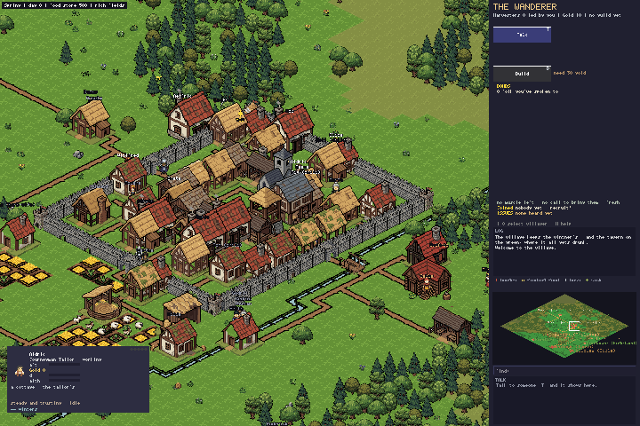
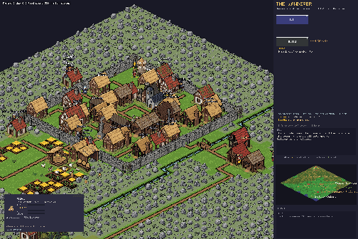

# The Wanderer

A medieval village simulation about earning trust and organizing for change.
You arrive as an outsider, meet the villagers, learn what troubles them, and
build relationships before asking anyone to join you.

Start with the [quick start and controls](PLAY.md).

## Playthroughs

**A walk through the village**

**A winter day in the village**

