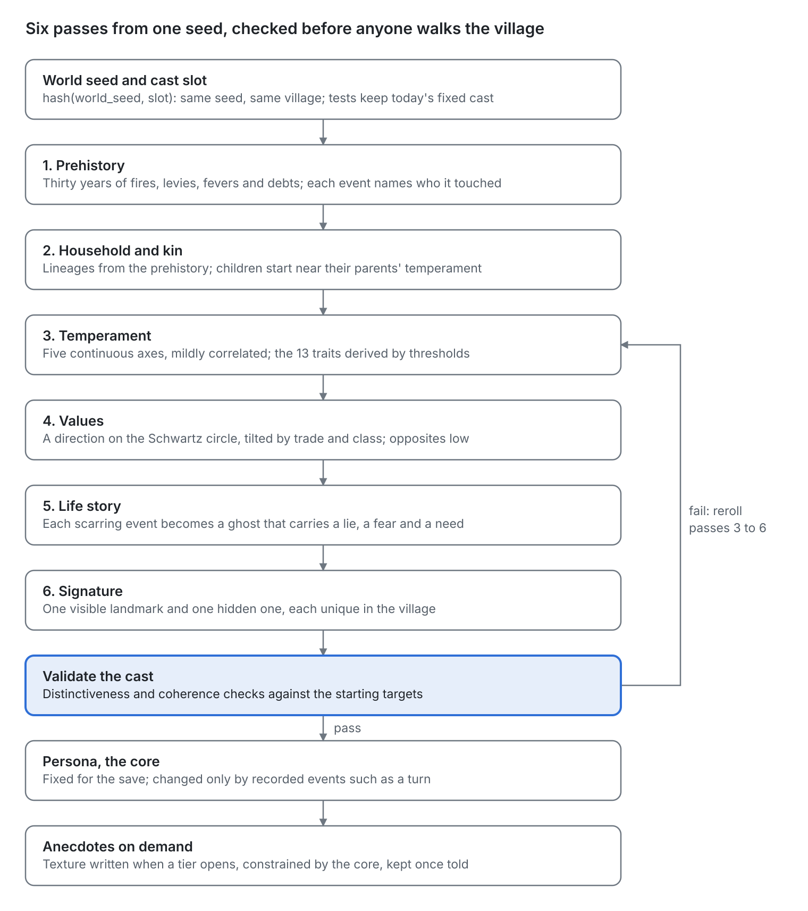
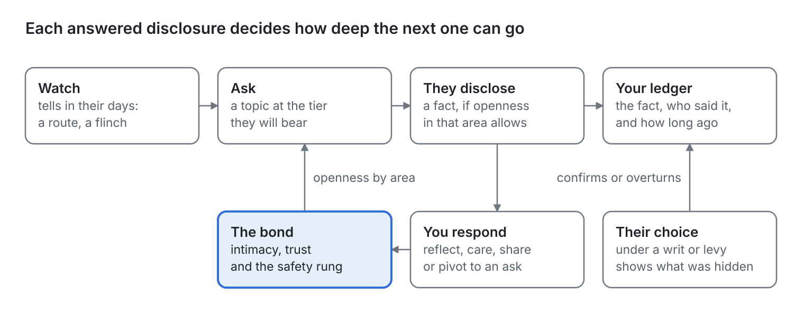
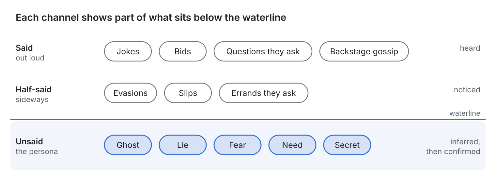

# Procedural Characters With Depth — Research Report and Design

Gary Sieling · Nov 22, 2026

## Summary

Treat each villager the way Minecraft treats a world: one seed, a few smooth axes, a recognizable type, one memorable landmark, and detail generated only when the player gets close enough to see it. Then let the campaign put pressure on people the player has come to know, because that is where depth shows and where players come to care.

- **The engine is ready; the people are thin.** Your talk engine already speaks any fact a villager carries. But the cast is the same 31 people in every world, and the depth pools are small: 9 of 31 villagers carry the same soldier brother.
- **Generate in six passes from the world seed:** shared prehistory, household, temperament, values, a life story where each wound carries a false belief and a need, and a unique signature. Reject casts that fail distinctiveness checks.
- **Make depth surface by a rule of three.** Every hidden fact gets a tell in behavior, a line at a disclosure tier, and a choice under pressure that only it explains. A fact that can't have all three should stay cheap or be cut.
- **Model getting to know someone as research describes it.** Topics and tiers open through reciprocal disclosure met with responsive replies. Split the bond into intimacy, trust (ability, benevolence, integrity) and a psychological-safety rung that maps onto your existing ask ladder.
- **Build for the player's feelings without metering them.** Players attach through specificity, being remembered, shared history, stakes and change. Callbacks, a ledger of what you know, and curated beats do that work.
- **Let the campaign reveal character.** Ganz's emotions decide whether people act, each wound's belief gets tested by events, and asks become choices that show who people are. Make listening pay even when no ask follows, or the game teaches manipulation.
- **Give villagers a voice, not a template.** Replace `fill()` with a small realizer that gets thou and you, address, plurals and tense right. Then let stance, the shape of a refusal, a few style settings and one personal habit carry personality (Part 5).
- **Let them reveal themselves sideways.** Worry questions at the door, bids for safety, jokes, errands, visible evasions, rare slips, and different talk in public and backstage show what sits below the waterline. Every shadow must be cast by a real fact (Part 6).

**Start with Wave 1 in Appendix B:** the cast report, the line lint and structural checks, the realizer and lexicon behind `fill()`, and moving knowledge to each seat. None of these depends on another. Appendix A covers testing at five scales, from single lines to playtests.

## The game today

The Wanderer already has the plumbing a deep-character system needs; what it lacks is variety and causality inside each person. The talk engine (`game/conversation.rs`) is a Ruskin-style fact cascade with CiF-weighted forks, Façade-style acts and Versu-style spent lines. Anything put into a `Speaker`'s facts can be spoken. The problem is what goes in.

As read from `main` at efc908c (PR #1399), the layers that make up a villager are:

| Layer | Where | What the talk gets from it | Gap |
| --- | --- | --- | --- |
| 13 traits | `game/traits.rs` | weights on reply forks; the audition test (#1187) | keyed to cast index, not world seed; 26 distinct sets across 31 villagers; Osric, Edith and Anselm carry Lazy + Ambitious, which `opposite()` forbids |
| Big Five floats | `sim/psychology.rs` | one word on the card; one extraversion check in `society.rs` | a second personality model the talk never reads |
| Attachment history | `sim/psychology.rs` | the Nature word; how fast bonds move | seeded from `i % 6` and `4 - i % 5`, a formula rather than a life |
| Virtues | `game/virtue.rs` | status words (`kind_soul`, `upright`) | seeded from traits, so it adds no new information at start |
| Hooks, old wounds (#1243) | `game/hooks.rs` | `self:hook:*` statuses; laid to rest at deep bond | 8 authored, 6 can start; 9 of 31 villagers carry "the brother who went to soldier", 11 carry none |
| Wants and problems | `game/desires.rs` | the secrets a 1-1 reveals (15% per talk, +10% per parallel complaint) | wants are drawn from 13 types, weighted by class and trade; most problems are computed from today's circumstances |
| Vocation, class, skill | `game/vocation.rs` | trade facts, `{trade}` slots, trade-weighted counsel | the one identity layer that really varies per seed |
| Knowledge and stage | `desires::Known`, `organizing::stage_of` | asks unlock by rung | "Known" means 3 secrets heard or 1 deed done; the card then shows every trait at once |
| Talk memory | `session/dialogue.rs` | mood carried 20 days; amends; tiredness; the audition's vibe | remembers how the last talk ended, not what was said in it |
| Backstory | `dialogue_trees::backstory` | present-tense trait sentences ("They bow to no one.") | no past; "Ask about themselves" answers "Same story as the next one's, only mine." |
| Tales | `sim/story.rs` | the LIFE card's theme | a good record of in-game history, not yet fed back into talk |

The trait and hook counts come from re-running `personality_from_seed(i*7+3)` and `hooks::seed(i)` for the 31 entries in `NAMES`.

**Psychological safety, today, is the audition.** Early in a talk the villager tests you with the question their dominant trait asks of the world. Pass and the vibe reads `Safe`, and asks open one rung deeper. Fail and the talk stays on the polite tail. It is a good seed, but it is one roll per talk, not a state the relationship builds.

**Vocation is your best example of structure done right.** It changes what a person needs (inputs, a master), what they complain of ("no master (mason)"), whom they listen to, and which troubles echo. Most of this design generalizes that pattern to the rest of the person.

Five consequences follow:

1. **The cast isn't random yet.** Aldric is Stingy with a miller's debt in every world; only trade, skill, wants and gold change with the seed.
2. **The depth pools are small next to the cast.** Nine villagers with the same soldier brother is Kate Compton's oatmeal problem at village scale: many outputs, few that feel different.
3. **The layers don't explain each other.** The wound doesn't account for the trait, and the trait doesn't account for the want. Getting to know someone means inferring the rest from a part, and there is nothing yet to infer.
4. **Knowledge is a counter, not a picture.** "Known" is three items heard. The player never holds a partial or wrong impression that later gets corrected.
5. **The architecture is ready.** Depth enters by adding facts to `speaker_of` and lines keyed to them. No new conversation engine is needed.

## The Minecraft lesson: structure first, then novelty

Minecraft is endless but learnable because a few smooth, shared fields decide everything, named categories make regions recognizable, and rare structures give you something to steer by. People can be generated the same way, and The Wanderer already holds most of the parts.

**How Minecraft does it.** Three fractal noise maps shape the land: continentalness (how inland), erosion (how flat) and peaks and valleys, turned into height by splines ([Dawnosaur](https://dawnosaur.substack.com/p/how-minecraft-generates-worlds-you)). Temperature and humidity maps then pick a biome from a table. A sixth map, weirdness, produces rare variants such as ice spikes.

**Why it doesn't feel like oatmeal.** Kate Compton's warning: a generator can make 10,000 bowls of oatmeal, each mathematically unique, and the viewer just sees a lot of oatmeal ([Compton, 2016](https://galaxykate0.tumblr.com/post/139774965871/so-you-want-to-build-a-generator)). She separates perceptual differentiation (not identical to the last one) from perceptual uniqueness (a main character versus a face in the crowd). Most of a village can be differentiated background; a few people must be unique.

**Why players can find their way.** Kevin Lynch found that people hold a city in their heads as paths, edges, districts, nodes and landmarks ([The Image of the City, 1960](https://en.wikipedia.org/wiki/The_Image_of_the_City)). A village has the same five elements socially. Routines are paths; class, faith and feud lines are edges; trades and households are districts; the well and alehouse are nodes; memorable people are landmarks.

**Why depth has to be visible.** Tynan Sylvester's Player Model Principle: a simulation is worth only the mental model players can form of it ([The Simulation Dream](https://gamedeveloper.com/design/the-simulation-dream)). Noah Wardrip-Fruin names the failure the Tale-Spin effect: rich internal processes that leave no trace on the surface ([Expressive Processing](https://grandtextauto.soe.ucsc.edu/2008/02/21/ep-54-the-tale-spin-effect/)).

| Minecraft | What it buys the player | The people version | The Wanderer now | Proposed |
| --- | --- | --- | --- | --- |
| One world seed | A world you can learn, return to and share | A cast seeded from the world seed, stable within a save | identity keyed to cast index, the same in every world | `hash(world_seed, slot)`; today's fixed cast kept as a test scenario |
| Smooth, correlated noise fields | Nearby places resemble each other | A few continuous axes with correlations; kin resemble kin | 13 traits drawn from a fixed cycle; Big Five floats unused by talk | continuous axes, traits derived by thresholds |
| Biomes: named regions of parameter space | Instant recognition and expectations | About 10 archetypes, each with a voice register | trade voice only | an archetype register per villager |
| Structures and landmarks | Reference points, goals, stories | One visible signature per person, plus one hidden landmark | 8 hooks, heirlooms, smells | a signature guaranteed unique in the village |
| Rivers and roads | Movement between regions | Kinship, debts and shared past events | bonds, tales, trails | a prehistory whose events several households share |
| Lazy chunks, consistent with global fields | Endless detail at low cost | Anecdotes written when a disclosure tier opens, constrained by core facts | none | lazy anecdotes, kept once told |
| Weirdness: rare variants | Surprise without chaos | Deliberate contradictions and secret passions at a set rate | accidental (Lazy + Ambitious) | voiced contradictions in about 1 in 6 villagers |

One difference matters. Terrain holds still, while people change, leave and die. Your fog-of-war memory-fade design (`wiki/software-design/fog-of-war-memory-fade.md`) is the right answer: what the player knows about someone goes stale, and noticing the change is itself information.

## Lessons from character-simulation games

The games players remember characters from store what happened between the player and the character, and pair a stable identity with variable content. Your `docs/dialogue/` notes already audit nine games as conversation systems. This section asks a different question: how do games generate and deepen the people themselves?

| Game | What it generates | What makes it feel deep | What to take |
| --- | --- | --- | --- |
| [RimWorld](https://rimworldwiki.com/wiki/Backstories) | A childhood and an adulthood backstory, each setting skills and sometimes disabling work | any childhood pairs with any adulthood, and a background "cannot fixedly say anything about who the character is now" ([writing guidelines](https://docs.google.com/document/d/1HmLwOYk8e_kyQ4nEEfHtLr-vvPb03vkaOntnrVlPKM0/pub)) | a two-slot past that sets skills and values, never present mood |
| [Dwarf Fortress](<https://dwarffortresswiki.org/index.php/Memory_(thought)>) | Facets, values and dreams; 8 short-term and 8 long-term memory slots | a recalled memory can become a core memory that permanently changes a facet or value, shown with the event and year | personality that moves for a recorded reason |
| [Caves of Qud](https://pcgworkshop.com/archive/grinblat2017subverting.pdf) | Mythic biographies for its sultans | events come first; a state machine and replacement grammar explain them afterward | generate the life event, then pick the reason |
| [Shadow of Mordor](https://www.gdcvault.com/play/1025150/contactUs) | Named orc captains with traits and ranks | orcs remember your encounters and answer by personality, built to be loved and hated | callbacks make even enemies personal |
| [Watch Dogs: Legion](https://news.ubisoft.com/en-us/article/4po3S9Pwp1YcgBmGPmQxAh/watch-dogs-legion-the-tools-that-built-london) | Demographic profiles consistent with role, plus schedules and kin and social networks | memories and affinity spread along links; helping someone can warm their relatives to you and your cause | reputation travels through kin; tagging the data is the big cost |
| [Narrative Legos](https://pcgamer.com/ken-levine-outlines-his-system-for-replayable-narrative-in-games) (GDC proposal) | About five "Stars" per village, passions drawn from a pool written for each | name, voice and personality stay fixed; most passions show; secret ones surface once the Star trusts you | fixed identity, varied passions, trust-gated secrets |
| [Football Manager](https://www.fmscout.com/a-guide-to-player-personalities-football-manager.html) | Visible and hidden attributes that combine into descriptors such as Model Professional | you learn personality from reports and from behavior, including reactions to private conversations | show a word, hide the numbers, let observation reveal them |
| [Through the Darkest of Times](https://store.steampowered.com/app/1003090/Through_the_Darkest_of_Times/) | Resistance members with a job, a political affiliation and five skills (propaganda, empathy, secrecy, strength, literacy); two join at random, more are recruited | a politically mixed group brings internal conflict to resolve; the reviewer finds little character development ([E-IR review](https://uwe-repository.worktribe.com/OutputFile/12773074)) | the closest organizing analog, and the gap your game can fill |
| [Animal Crossing](https://animalcrossing.fandom.com/wiki/Villager) | Eight personality types that set dialogue and voice | a type reads within a minute; individuals vary inside it | archetypes as voice registers |
| [XCOM](https://www.gamedeveloper.com/design/why-do-we-get-so-attached-to-our-soldiers-in-xcom-) | Randomly generated soldiers | permadeath and shared hardship; each survived mission adds to their story | shared risk and accumulated history beat authored backstory |

Three lessons cut across the table:

1. **Depth is mostly memory.** Nemesis, Dwarf Fortress and XCOM feel deep because they store what happened, not because they store more traits.
2. **Fix the identity, vary the content.** Levine and Animal Crossing keep each person recognizable and randomize what they care about. That suits a game where you talk to the same 30 people for hours.
3. **The cost is data and tuning.** Ubisoft's Census team called getting the tagging into the world a major effort, and tuning procedural output hard. Build the measuring tools before the content.

## Lessons from research systems

Research systems add three things shipped games mostly lack: beliefs about people that carry a source and a confidence, memory retrieval that picks the right past moment, and ways to measure a generator's range. Façade, Comme il Faut and Versu are already in `conversation.rs`, so they are left out here.

| System | Core idea | What to take |
| --- | --- | --- |
| [Talk of the Town](https://ojs.aaai.org/index.php/AIIDE/article/view/12825) (Ryan, Summerville, Mateas, Wardrip-Fruin, 2015) | Characters observe, form knowledge, pass it on, misremember, forget and lie | gossip is how the player learns about people, and every fact remembers who said it |
| [Bad News](https://eis.ucsc.edu/papers/ryanEtAl_BadNewsCHI2016.pdf) (2016) | A town simulated from 1839 to 1979 with several hundred residents; the actor sees what a character knows about anyone, with source and strength | working out who someone is, through others, is itself the play; source plus strength per belief is the right data shape |
| [Curating Simulated Storyworlds](https://escholarship.org/uc/item/1340j5h2) (Ryan, 2018) | Emergent stories work like nonfiction and need curation; failures include boringness, granularity extremes and poor presentation ([Emily Short's notes](https://emshort.blog/2019/05/23/curating-simulated-storyworlds-james-ryan-2/)) | a telling layer that chooses which moments reach the player |
| [Generative Agents](https://ar5iv.labs.arxiv.org/html/2304.03442) (Park et al., 2023) | Memories scored by recency (0.995 decay per game hour), importance (rated 1 to 10) and relevance; reflections form when recent importance passes 150; removing memory, planning or reflection lowered believability | keep the scoring, drop the language model: relevance from concept tags, importance authored |
| [Beyond Branching](https://emshort.blog/2016/04/12/beyond-branching-quality-based-and-salience-based-narrative-structures/) (Short, 2016) and the [storylets map](https://mkremins.github.io/publications/Storylets_SketchingAMap.pdf) (Kreminski and Wardrip-Fruin, 2018) | Content chosen by state; in salience-based systems the most specific match wins | your Ruskin cascade already is this; extend its criteria to memories and disclosure tiers |
| [Expressive range](https://www.pcgworkshop.com/archive/smith2010analyzing.pdf) (Smith and Whitehead, 2010) | Chart the space a generator covers and its bias within that space | chart the whole cast, not single characters |
| [Expressive Processing](https://grandtextauto.soe.ucsc.edu/2008/03/11/ep-81-eliza-and-simcity) (Wardrip-Fruin, 2009) | In the SimCity effect, surface elements have counterparts inside, so play builds an accurate model | aim for it: every hidden variable gets a visible tell |

**On language models.** Your repo calls Ollama only from development agents (`infra/ollama.rs`, `agents/`); nothing in `session/` or `game/` does. Keep it that way at runtime, because determinism per seed and the wasm build depend on it. The ideas transfer without the model: Generative Agents' three-part retrieval score works fine on concept tags.

**Further reading.** [Procedural Storytelling in Game Design](https://www.routledge.com/products/9780429488337) (2019) has a Characters section: Tanya X. Short, "Maximizing the Impact of Generated Personalities"; Card, Tjernø and Bozarth, "Procedural Characters in State of Decay 2"; Jongwoo Kim, "Generating Personalities in The Shrouded Isle"; and Elan Ruskin, "Dialog". It also has Jason Grinblat, "Generating Histories". [Procedural Generation in Game Design](https://www.routledge.com/products/9781498799195) (2017) adds Emily Short, "Characters and Personalities", and Kenny Backus, "Managing Output: Boredom versus Chaos".

## What depth is

A character feels deep when the layers explain each other: stable dispositions, the values and goals built on them, and a life story that accounts for both. Forster's test is the practical one: a round character can surprise you in a convincing way.

**Personality science gives the layers.** McAdams and Pals describe personality as dispositional traits, characteristic adaptations (motives and goals that vary with time, place and role) and integrative life narratives, all shaped by culture ([summary of McAdams & Pals, 2006](https://cee.nd.edu/news/documents/McAdamsSummary.pdf)). Culture shapes traits only modestly, adaptations more and life stories most. For a medieval village, the period should show most in the stories people tell about themselves.

**Values give coherence for free.** Schwartz's ten basic values sit on a circle that captures which values conflict and which go together, with evidence from 82 countries ([Schwartz, 2012](https://cris.huji.ac.il/en/publications/an-overview-of-the-schwartz-theory-of-basic-values/)). For a generator that is a gift: pick a direction on the circle and the opposite values come out low, so random draws stay plausible.

**Conflict between layers is depth; conflict inside a layer is noise.** In Dwarf Fortress a dwarf can value romance yet be unable to form romantic bonds ([DF wiki](https://dwarffortresswiki.org/index.php/DF2014:Personality_facet)). That is a character. Lazy plus Ambitious drawn from adjacent slots in a list is a bug.

**Flat is fine at first sight.** Forster's flat characters are built round a single idea, his round ones surprise convincingly, and he argued a novel needs both ([Kenyon Review](https://kenyonreview.org/2018/08/in-defense-of-flat-characters/); [Aspects of the Novel, ch. 4](https://standardebooks.org/ebooks/e-m-forster/aspects-of-the-novel/text/chapter-4)). A villager can read as a type on day one and turn round as you get to know them.

**Pressure reveals.** Robert McKee separates characterization, everything observable, from true character, which shows only in choices under pressure ([Story, excerpt](https://writersstore.com/blogs/news/structure-and-character-excerpted-with-permission-from-the-book-story-part-one)). The campaign supplies the pressure.

**Wounds need a lie.** In K.M. Weiland's arc model, the ghost, or wound, is why a false belief took root ([ghost](https://www.helpingwritersbecomeauthors.com/character-arcs-4/)). The want is an outer goal chased as a cure for that belief's symptoms, and the need is the truth that answers it ([want and need](https://www.helpingwritersbecomeauthors.com/character-arcs-3/)). Your hooks are ghosts without lies; adding the lie gives each wound a behavior today and a way to change.

| Layer | What it holds | Example: a generated alewife | How the player learns it |
| --- | --- | --- | --- |
| 1. Surface | name, age, trade, household, smell, routine, repute | Edith, 34, widowed alewife; at the well each dawn; smells of malt | sight and gossip |
| 2. Temperament | five continuous axes; the 13 traits derived from them | quick to warm, slow to anger, restless | behavior over days; the card's one word |
| 3. Adaptations | values, wants, fears, the question she tests strangers with, deference to the lord | security first, then care; wants the brewhouse lease; fears the bailiff; asks whether you pay your debts | talk at tiers 1 and 2 |
| 4. Life story | prehistory events, ghost, lie, need, secret | husband taken by the levy nine years ago; believes the lord's men always come back; needs not to stand alone; still owes the miller | tier 3 talk, and what she does under pressure |

## How people get to know each other

Closeness grows through reciprocal disclosure that deepens step by step and is met with responsiveness. Trust grows from evidence of ability, benevolence and integrity. Safety is a shared belief about the room, not the pair, so the organizer builds it in meetings as much as in one-to-ones.

| Finding | Source | Mechanic it suggests | Where it lands in the code |
| --- | --- | --- | --- |
| Disclosure has breadth (topics) and depth (how personal); reciprocity opens deeper topics; when costs outweigh rewards people pull back | Altman and Taylor's social penetration theory, 1973 ([EBSCO](https://www.ebsco.com/research-starters/communication-and-mass-media/social-penetration-theory)) | facts tagged by area and tier; openness per area; a cooled bond closes tiers again | `desires::Known` becomes per-seat knowledge; `Topic` gains `area` and `tier` |
| Three sets of questions, each more personal, partners alternating, produced more closeness than 36 small-talk questions | Aron et al., 1997 ([Greater Good](https://ggia.berkeley.edu/practice/36_questions_for_increasing_closeness)) | three question tiers, and the player has to disclose too | `ASK_TOPICS` gains tiers; a new "tell of yourself" move |
| Intimacy comes from disclosure plus perceived responsiveness, which partly mediates it; disclosing emotion predicts intimacy more than disclosing facts | Reis and Shaver's model, tested by Laurenceau et al., 1998 ([abstract](https://nmr.mgh.harvard.edu/publications/journal_articles/2791)) | reply types that reflect, validate, care, advise, deflect or pivot; feeling lines count more than fact lines | replies get a responsiveness tag; `chat_temp` weighs it |
| Trust is a willingness to be vulnerable; trustworthiness has three parts, ability, benevolence and integrity, plus each person's propensity to trust | Mayer, Davis and Schoorman, 1995 ([summary](https://sk.sagepub.com/ency/edvol/embed/encyclopedia-of-management-theory/chpt/trust)) | three trust components per bond, one propensity per person | `Relationship` components; `Wary` becomes low propensity |
| Team psychological safety is a shared belief that the team is safe for interpersonal risk taking, and it goes with learning behavior | Edmondson, 1999 ([Harvard DASH](https://dash.harvard.edu/entities/publication/13a7b031-0fdd-45ec-a7e0-2b80e2bc679f)) | a safety score for the meeting room, raised for everyone present when dissent is handled well | `meetings.rs`; `REVEAL_PARALLEL` scaled by room safety |
| Safety builds in four stages, inclusion, learner, contributor and challenger, each a social exchange | Timothy Clark, 2020 ([handout](https://www.usi.edu/media/iemobz01/marsha-hughes-rease_4_stages_handout.pdf)) | a safety rung per org member | lines up with ComeAlong, then meeting roles, then CoLeader |

Two findings change the current design most. First, depth needs reciprocity: today the player only asks, and the Wanderer's own story appears only as meeting testimony (#1248). Second, Clark's top stage is "air cover in exchange for candor": people challenge the lord, or you, only if the org has shown it protects those who speak. Your README already has the mechanism, a strong org standing with its own, so the rung can read off it directly.

## Why players come to care

Players attach to characters in several distinct ways, and procedural characters earn it through shared history, stakes and being remembered rather than through authored backstory. A bond meter records the relationship; it does not create the feeling.

**Attachment has kinds.** A survey of 213 players found seven forms of emotional attachment, from excitement at a character's gameplay competence, to admiring them as a role model, to deep concern for their well-being ([Bopp et al., 2019](https://edoc.unibas.ch/73889)). An organizing game can reach the strongest of these, concern for well-being, because the player asks people to take risks.

**Attraction has parts.** In a survey of role-playing gamers, attachment to characters was real and came from the players' own personality and motives combined with how attractive, friendly or hostile, and useful the characters were ([Coulson et al., 2012](https://repository.mdx.ac.uk/item/83q53)).

**Players co-author.** Sylvester calls the habit of reading intent and emotion into simple events apophenia, and treats the player as co-author of the story ([The Simulation Dream](https://gamedeveloper.com/design/the-simulation-dream)). XCOM's director described his job as building the stage and handing the player props ([Kotaku](https://kotaku.com/remembering-the-fallen-and-the-decisions-for-which-the-5916627)). One player's account of XCOM attachment credits shared hardship far more than customization ([Game Developer](https://www.gamedeveloper.com/design/why-do-we-get-so-attached-to-our-soldiers-in-xcom-)).

**Hate counts too.** Monolith designed the Nemesis system to maximize players' positive and negative emotions toward procedural orcs ([GDC 2018](https://www.gdcvault.com/play/1025150/contactUs)). The steward who always informs, the reeve who remembers you shamed him: rivals the player hates are attachment too.

**Games move people through choice.** Isbister argues that games stand apart because players shape outcomes through their own efforts. That adds social emotions such as guilt and complicity, which passive media rarely produce ([How Games Move Us, excerpt](https://thereader.mitpress.mit.edu/how-games-move-us/)). The feeling comes from having chosen.

| Lever | Why it works | How The Wanderer pulls it |
| --- | --- | --- |
| Specificity | a remembered particular beats a trait | a unique signature per villager; heirlooms; smells |
| Being remembered | knowing runs both ways | callbacks to what you did, generalizing "You're the one who finally asked after..." from hooks to all shared episodes |
| Shared history | every risk survived together adds to the story | tales, shared bits and meals, surfaced in talk and on the card |
| Stakes | concern for well-being is the strongest form | writs, summons, the levy, the stocks; your asks put people in harm's way |
| Change | people change because of you | a ghost's lie weakens and they say so; thaw rungs; recorded core memories |
| Competence | admiration needs someone better than you at something | masters, organic leaders and the herb-wife know things the Wanderer doesn't |

## Organizing practice as game design

Organizing already is a getting-to-know game: the one-to-one discovers self-interest, agitation and hope decide whether someone acts, and escalating asks are choices under pressure that show who people are. Your wiki maps Labor Notes, Ganz, Chambers, McAlevey and Han onto campaign mechanics. What it doesn't yet do is turn them into variables inside each person.

**Emotions that stop or start action.** Ganz writes that some emotions inhibit action and others enable it ([What Is Public Narrative](https://changemakerspodcast.org/wp-content/uploads/2017/09/Ganz-WhatIsPublicNarrative08.pdf)). Urgency and anger get attention; fear paralyzes, amplified by self-doubt and isolation. Hope, with a sense that you can make a difference and with solidarity, moves people to act.

That list is a ready-made state model. Each villager can hold five tensions: inertia against urgency, fear against hope, isolation against solidarity, self-doubt against efficacy, and anger, which can tip either way. Temperament sets the starting point and the life story sets the scars.

**Groups move one notch at a time.** Training for Change's spectrum runs from active support through passive support, neutral and passive opposition to active opposition. Change is usually won by moving key groups one step, not converting everyone at once ([Training for Change](https://www.trainingforchange.org/?p=11508)). A trade, a congregation or a household can sit on that spectrum, computed from its members.

**Charting is a guess.** Your IWW notes already treat `stage_of` as the 1 to 5 chart. The design change is to show the player's estimate, not the truth, and let structure tests reveal how wrong it was. Overestimating support is the classic organizer's error, and the game can teach it.

**Leaders are found, not named.** McAlevey's organic leaders, already in your wiki, are the people others follow. In character terms they are a hidden landmark: often a Quiet Hand, rarely the loudest Firebrand.

| Organizing concept | Variable inside the person | Conversation move | Hook already in the code |
| --- | --- | --- | --- |
| Self-interest (IAF) | top values, live wants, the ghost's need | one-to-one at tiers 1 to 3 | `Known`, `KNOWN_PIECES` |
| Agitation | urgency, anger | "How does that sit with you?" | the Labor Notes arc in `dialogue_trees.rs` |
| Inoculation | expected fear | name the lord's answer in advance | #1246 |
| Hope and efficacy | hope, self-doubt | stories of wins; small asks completed | testimony #1248; thaw rungs #1269 |
| Solidarity | isolation | meals, meetings, parallel complaints | `REVEAL_PARALLEL`; meals #1241 |
| Charting 1 to 5 | the player's estimate against the true stance | your read on the card | `stage_of` |
| Organic leader | pull, respect, people who rely on them | "Who do folk turn to?" | Scout #1249; `pull_of` |
| Spectrum of support | a group's position | per trade, congregation, household | guilds, factions |

One principle governs all of it. Relational organizing fails when it turns transactional, and a game that pays for intimacy with asks teaches exactly that. The design in the next sections makes listening pay even when no ask follows.

## Medieval texture

Medieval records hand you event tables for believable lives: coroners' inquests for accidents, manorial courts for debts and land, and church trials for what ordinary people privately believed. Generating a short village prehistory from them gives every wound a cause that other villagers also remember.

**Accidents and households.** Barbara Hanawalt's *The Ties That Bound* builds peasant family life from over 3,000 coroners' inquests into accidental deaths and from manorial court records ([LibraryThing](https://www.librarything.com/work/41287)). It covers the household as an economic unit, the stages of life, hardship and how families adapted after the Black Death. It is the right source for hazard rates and household shapes.

**Private cosmologies.** Carlo Ginzburg's *The Cheese and the Worms* follows Menocchio, a miller questioned by the Inquisition in 1583, who explained creation as a mass like cheese out of which worms, the angels, appeared ([MIT Press Reader](https://thereader.mitpress.mit.edu/?p=15267)). He was unusually literate for a miller and recast what he read in everyday terms ([JHU Press](https://press.jhu.edu/books/title/10626/cheese-and-worms)), though Ginzburg traced the core of his ideas to an oral peasant tradition. Some villagers should hold one odd, private belief; `old_ways` and the `Doctrine` problem are the start.

**Gossip on the record.** Your premodern-resistance review already uses Montaillou's inquisition records for the counter-cycle. The same records show a village's gossip networks as an investigator mapped them, which is the Bad News pattern in real history.

| Prehistory event | Record it mirrors | Who it touches | Ghost it can seed | Lie it can teach |
| --- | --- | --- | --- | --- |
| Barn or house fire | coroners' inquest | household, neighbors, whoever was blamed | `burnt_barn`, `blamed_neighbor` | the village always finds someone to blame |
| The lord's levy | muster, manor accounts | 2 to 4 young men across families | `brother_soldier`, `brother_fate` | the lord's wars take our sons |
| Death duty on an inheritance | manorial court | the heir's household | new | the lord takes even from the dead |
| Fever year | parish burials | several households at once | `child_buried` | God sends what God sends |
| Debt to the miller | manorial court | debtor households | `miller_debt` | the mill owns us |
| Broken betrothal | church court | the couple and both kin | `broken_troth` | promises are for those who can keep them |
| Old faith put down | church visitation | one household | `old_faith` | keep your true self hidden |
| Eviction for arrears | manorial court | a household, and neighbors who took the land | new | never cross the reeve |
| A great harvest feast | manor accounts | everyone | a warm memory, not a ghost | we were strong together once |

Not every lesson is a lie. A fire can teach "the truth comes out if someone says it" to a person who stood up afterward. Mixing true and false beliefs keeps the cast from reading as a ward of victims.

## Design part 1: the character generator

Generate each villager from the world seed in six passes: shared prehistory, household, temperament, values, a rationalized life story and a unique signature. Then reject casts that fail coherence and distinctiveness checks, the way Compton's generate-and-test filters content against hard constraints.



A cast that fails a check rerolls passes 3 to 6 for the offending villager, so the shared history and households stay fixed.

**Pass 1, prehistory.** Run the 30 years before play with the event table from the previous section; each event records who it touched. This is what turns nine identical soldier brothers into one levy that took three men, with three different fates and three households that remember it differently.

**Pass 2, household and kin.** Place people into households and lineages from the prehistory. A child's temperament starts at the parents' mean plus noise, so families resemble each other the way neighboring terrain does.

**Pass 3, temperament.** Draw the five axes already in `sim::psychology::Personality`, mildly correlated and pulled toward the person's archetype. Add one new axis, trust propensity, set by childhood events. Derive the 13 discrete traits by threshold, so `traits::Personality` keeps feeding the reply weights unchanged:

| Trait | Derived when (axes and values on 0 to 1) |
| --- | --- |
| Kind | agreeableness above 0.70 |
| Cruel | agreeableness below 0.15 |
| Hotheaded | neuroticism above 0.65 and agreeableness below 0.40 |
| Steady | conscientiousness above 0.60 and neuroticism below 0.35 |
| Gregarious | extraversion above 0.70 |
| Stolid | extraversion below 0.25 and neuroticism below 0.40 |
| Wary | trust propensity below 0.30 |
| Lazy | conscientiousness below 0.25 |
| Ambitious | Advancement or Standing among the top two values |
| Proud | Standing high and agreeableness below 0.50 |
| Stingy | Safety high and Care low |
| Pious | Custom high and faith devotion above 0.60 |
| SelfAbsorbed | extraversion above 0.65 and agreeableness below 0.30 |

The thresholds are starting points for tuning. Lazy plus Ambitious can still occur, but only as low conscientiousness against a high Advancement value, and the person is then tagged `contradiction:idle_striver` with lines of its own.

**Pass 4, values.** Pick a direction on the Schwartz circle and let each value fall off with angle, so opposites come out low. Trade and class tilt the direction: the priest toward Custom, the trader toward Advancement, field hands toward Safety and Care. Village names for the ten: Freedom, Adventure, Pleasure, Advancement, Standing, Safety, Propriety, Custom, Care and Fairness.

**Pass 5, life story: generate, then rationalize.** For each prehistory event the person was in, roll whether it left a mark, weighted by severity and neuroticism. A deep mark becomes a ghost carrying a lie (a belief with a strength), a fear and a need. As in Caves of Qud, nothing simulates why; the reason comes from a small table keyed by event and temperament. A fire teaches a fearful person to keep their head down and a person high in Fairness that the truth comes out.

**Pass 6, signature.** Give each person one visible landmark (a thing, a habit, a phrase or a place) and one hidden landmark (a secret passion, a skill, a past). Generate and test: no two villagers share a signature.

```rust
/// game/persona.rs: the deep model, seeded once and changed only by recorded events
pub struct Persona {
    pub seed: u64,                    // hash(world_seed, slot)
    pub archetype: Archetype,         // the biome: voice register and priors
    pub temperament: [f32; 5],        // O, C, E, A, N as in sim::psychology
    pub trust_propensity: f32,        // childhood events; Wary derives from it
    pub values: [f32; 10],            // Schwartz circle, village names
    pub story: Vec<EventId>,          // prehistory events this person was in
    pub ghosts: Vec<Ghost>,           // wound, lie, fear, need
    pub signature: Signature,         // visible landmark, unique in the village
    pub hidden: Landmark,             // secret passion, skill or past
    pub contradiction: Option<Contradiction>,
}

pub struct Ghost {
    pub event: EventId,
    pub hook: usize,                  // index into hooks::HOOKS, kept
    pub lie: Belief,                  // e.g. Belief::LordAlwaysWins
    pub strength: f32,                // 0..1; campaign events move it
    pub fear: Fear,
    pub need: Need,                   // what the campaign can give
}
```

The archetypes are the biomes: a region of temperament and value space with a voice register, a typical audition question and a tendency in a campaign. Ten or eleven is enough for recognition without sameness.

| Archetype | Region | Voice | Audition question | In a campaign |
| --- | --- | --- | --- | --- |
| Old Guard | Custom and Safety high, openness low | proverbs; as my father did | Do you respect how things are done? | slow to join, steadfast once in |
| Striver | Advancement high, conscientious | mastery and coin | Can you get things done? | joins if it pays, leaves if it costs |
| Soft Heart | Care high, agreeable | asks after others first | Do you care, or want something? | joins for others; hurt by transactional asks |
| Firebrand | Fairness high, low agreeableness or high extraversion | names wrongs and names names | Will you stand your ground? | first to act, hard to steer |
| Quiet Hand | Care and Propriety, conscientious, introverted | few words, practical | Will you do the work? | often an organic leader; unseen until asked |
| Tongue of the Well | extraverted, Adventure | news and other people's business | What do you know? | spreads word, and leaks |
| Burned | neurotic, a deep ghost, deferent | hedges; it's not my place | Are you safe to be seen with? | fearful; can turn steadfast after a win |
| Doubter | Freedom high, low trust propensity | questions, dry wit | Are you who you say? | the sharpest critic, and a valuable one |
| Devout | Custom high, devout | scripture and saints | Do you keep faith? | follows the priest, or the Gospel against him |
| Merrymaker | Pleasure high, extraverted | jokes, songs, ale | Are you good company? | fills rooms; unreliable on hard asks |
| Climber | Standing high, Care low | flatters upward | What can you do for me? | the lord's man in waiting; informer risk |

The audition question links to the existing `PROBE_TESTS`: today the dominant trait chooses it, and the archetype can choose it instead.

The cast-level checks, with starting targets to tune against the cast report:

| Check | Starting target | Why |
| --- | --- | --- |
| Villagers sharing a signature | 0 | perceptual uniqueness |
| Holders of one ghost type with no shared event behind it | at most 2 | stops the soldier-brother pile-up |
| Archetype spread | at least 6 present, none above 20% of the cast | variety with structure |
| Nearest pair in temperament and values | above a tuned floor; nearest pairs flagged | no oatmeal twins |
| Villagers with a deliberate contradiction | about 1 in 6 | surprise without chaos |
| Prehistory events touching two or more households | at least half | a shared story of us |

**What changes in existing code.** `setup.rs` calls `persona::generate(world_seed, slot, &prehistory)` instead of `personality_from_seed(i*7+3)`. The existing components become views of the persona:

- `traits::Personality` from Pass 3 thresholds.
- `hooks::Hooks` from Pass 5 ghosts, keeping `HOOKS` and adding lie, fear and need beside each entry.
- `InnerLife.wants` sampled with value priors: Care toward Love, Advancement toward Mastery, Safety toward Security.
- `AttachmentHistory` seeded from childhood events instead of `i % 6`.
- `Virtues::seeded` from values, for example Care toward Charity and Fairness toward Justice.
- `Domination.internalized_domination` from deference and any lie about the lord.

Detail beyond the core is lazy, like a chunk. When a disclosure tier opens, the generator writes one to three short anecdotes from templates filled with core facts, and stores them in a per-person `Told` list. Once told they are canon, and later lines must agree with them.

## Design part 2: how depth surfaces in conversation

Give every hidden fact a topic area, a disclosure tier, at least one tell and a few lines. The existing specificity cascade will then surface depth whenever the facts match, and the tiers decide how far in the player can reach.

**The rule of three.** A fact is shown before it is said, said before it is confirmed, and confirmed under pressure. It needs a tell in behavior, a line at its tier, and a choice that only this fact explains. A fact that can't have all three is what Sylvester calls hair complexity: keep it cheap or cut it.

| Tier | Like Aron's | What is shared | Opens when | Example line |
| --- | --- | --- | --- | --- |
| 0, public | before the sets | trade, kin, the day, the village | always | "The malt's late again." |
| 1, personal | Set I | opinions, likes, small troubles | after two talks | "I'd sooner brew than bake, truth be told." |
| 2, private | Set II | worries, hopes, the past, views of named people | openness in that area at least 0.4 | "My Hal went with the levy. Nine years." |
| 3, core | Set III | the ghost, the lie, the secret, the need | openness at least 0.7, and no one else in earshot | "I still set his bowl out. A fool's thing." |

Openness is computed per area, so a villager can talk freely about work and not at all about the lord:

```math
\mathrm{openness}_a = 0.30\,I + 0.25\,B + 0.20\,G + 0.15\,S + 0.10\,M - 0.20\,X
```

- I is intimacy, the breadth and depth reached so far.
- B and G are the benevolence and integrity parts of their trust in you.
- S is safety: their rung, or the room's score in a meeting.
- M is mood from the last talk (`TalkMemory`).
- X is exposure: 1 if the lord's man or a suspected informer can hear, else 0.

Temperament scales the result: extraversion raises tier 1, neuroticism lowers tier 3. The weights are starting values for tuning.

**Asking too deep, and asking well.** A question above the current tier reads as forward: the vibe goes to Mismatch and safety drops a little. But a question that names a tell the player actually saw ("You go quiet when the levy's mentioned") earns a bonus and can open the tier. That rewards attention instead of persistence.

**Reciprocity.** Add a "Tell of yourself" move that draws on the Wanderer's own history, the same events testimony uses (#1248). Matching their tier adds intimacy; overshooting, a tier-3 confession to a stranger, reads as strange.

| Reply type | Example after "Hal went with the levy" | Effect |
| --- | --- | --- |
| Reflect | "Nine years, and you still look to the road." | intimacy up, benevolence up |
| Validate | "Anyone would." | intimacy up |
| Care | "Who sits with you of an evening?" | benevolence up strongly; may open the need |
| Advise | "Petition the steward for his pay." | small intimacy; ability up if it works |
| Deflect | "Hard times for all." | nothing; repeated, it closes tiers |
| Pivot to the ask | "Will you sign the petition?" | integrity down, intimacy down, and remembered |

The reply types ride on the existing `Act` values as a responsiveness tag, and `chat_temp` weighs them.

**Tells.** Each fact carries one to three tells of three kinds:

- Routine: she walks to the cairn on the levy's anniversary, and avoids the gate when soldiers pass.
- Narration inside talk: "Her hand goes to her throat."
- Gossip in villagers' chats: "Don't speak of the levy to her."

**Callbacks from shared memory.** Each pair keeps episodes: day, kind, concept tags and an authored importance. Before a talk, score them the Generative Agents way, with concept tags in place of embeddings:

```math
\mathrm{score}(e) = 0.99^{\Delta d} + \frac{\mathrm{importance}(e)}{10} + \frac{|C_e \cap C_t|}{|C_e|}
```

Here Δd is days since the episode, C\_e its concept tags and C\_t the tags of the talk so far. The top one or two become facts in `speaker_of`, such as `mem:you_kept_promise`, `mem:you_missed_meeting`, `mem:you_stood_with_us`, `mem:you_asked_too_soon` and `mem:you_shared_meal`. The hook lines that say "You're the one who finally asked" are this pattern already; it should cover every kind of episode.

**Gossip about people.** Add an "Ask about \[name\]" topic. The answer is the speaker's belief about that person, from their own model, with a confidence, and it can be wrong. The ledger records who said it, as in Talk of the Town.

**A thread across three visits (illustrative).**

1. Visit 1, tier 0 to 1: Edith talks malt prices, then tests you: "Do you pay what you owe?" That is the Old Guard and Safety audition.
2. Visit 4, tier 2: you have seen her avoid the gate. You ask why, and she tells you about Hal and the levy.
3. The levy writ arrives: she is first at the meeting and says, "I sat quiet when they took Hal. Not again." Her lie, that the lord's men always win, has just lost strength, and the player saw it coming.

## Design part 3: getting to know someone, and caring

Keep what the player believes separate from what is true, split the bond into intimacy, trust and safety, and spend the player's attention on the moments where what they know meets what is at stake.



The bond, not the question, decides what the next talk can reach, and what people do under pressure confirms or overturns what your ledger says.

**The ledger.** Each villager gets a page the player fills in. In-world it is simply what you know of her. It shows:

- facts known, by area and tier, each with its source (she told you, someone else did, you saw it) and its age;
- what others say about her, flagged when it contradicts what you saw;
- silhouettes for areas never opened, such as "something about the lord";
- your read, a 1 to 5 stance with a confidence band, never the truth;
- staleness: "last spoke 40 days ago", and wants that may have changed since.

The ledger must belong to the seat. Today `desires::Known` sits on the villager, so in multiplayer every organizer shares one record of what anyone learned.

| Component | Moved by | Used for | In the code now |
| --- | --- | --- | --- |
| Familiarity | talks, meals, errands | opening tier 1 | `Relationship.interactions` |
| Intimacy | reciprocal disclosure met with responsive replies | opening tiers 2 and 3 | new |
| Trust: ability | promises delivered, wins, structure tests | asks that carry risk | new, read from campaign outcomes |
| Trust: benevolence | care replies, deeds, standing with them under a writ | openness | `Deeds` |
| Trust: integrity | promises kept, sincerity, no pivot to the ask | openness, ask acceptance | `INSINCERE_CHILL`, bought asks |
| Safety rung | see the ladder below | which org roles they will take | the ask ladder in `organizing.rs` |
| Warmth | all of the above, decaying | hearts, grief, follower threshold | `Relationship.strength` |

`strength` stays as the summary, recomputed from the components, so `FOLLOWER_TIE`, hearts and grief keep working.

| Rung (Clark) | The exchange, paraphrased | In The Wanderer | Unlocks | Breaks when |
| --- | --- | --- | --- | --- |
| Inclusion | belonging, for basic respect and no harm | greeted, named, fed at the meeting | ComeAlong | they are ignored or mocked in a meeting |
| Learner | support to learn, for engagement | they ask questions and voice doubts | Inoculate, Argue | a doubt is shut down |
| Contributor | autonomy and accountability, for results | they take a role: notes, song, venue | MeetingPlan roles | their work is unused or uncredited |
| Challenger | protection, for candor | they challenge the lord, or you | spokesman, CoLeader, open dissent | the org leaves them exposed |

**Emotional beats.** These are the moments to build for. Each is a payoff of knowing someone, not a separate system.

| Beat | Trigger | Why it lands | What builds it |
| --- | --- | --- | --- |
| Being remembered | a callback to something you did | knowing runs both ways | `mem:*` facts |
| The confession | the first tier-3 disclosure | you got there by caring | tier gates and responsive replies |
| The convincing surprise | a choice under pressure that a hidden landmark explains | Forster's round character | tells planted earlier |
| The change | a lie loses strength and they say so | they changed because of you | belief strength events |
| The reproach | they name a transactional move of yours | integrity matters | the pivot-to-ask memory |
| The loss | death, summons or exile of someone you knew deeply | concern for well-being | the funeral reads your ledger back |
| The return | repair after amends | relationships can recover | the amends move (#1251) |

**Curation.** Following Ryan, the sim needs a telling layer. Score candidate moments by how deeply the player knows the person, the event's intensity and its novelty. Allow about one major beat per in-game week. The storyteller (`arc_phase`) may aim pressure at people the player knows well, with a cooldown so loss never becomes routine.

**Rules against manipulation.**

1. A pivot to an ask in the same talk as a tier-2 or tier-3 disclosure costs integrity, unless the ask quotes the disclosure and serves their need. That is the self-said ask (#1247) done right.
2. People high in Care notice an asks-to-talk ratio that is all asks, and they say so.
3. Some people never join. Knowing them still pays in introductions, warnings and safety for others.

## Design part 4: tying people to the campaign

The campaign is the pressure that reveals character. Every ask, writ and meeting is a choice that the deep model decides and an attentive player can predict.

**What moves them.** A self-interest profile is the top two values, the live wants and the need behind each ghost. "Known" (`RelStage::Known`) changes from three secrets heard to knowing what moves them: two areas open to tier 2, one of them holding a value. Asks that serve the profile land. Asks that cut against it are refused, with a reason drawn from the model.

| Reason drawn from | Example refusal |
| --- | --- |
| A value: Safety | "I've three mouths. I can't be seen at a meeting." |
| A ghost's lie | "Last time names were gathered, my father lost his strip." |
| Fear | "The bailiff knows my face." |
| Isolation | "Who else is going?" |
| Self-doubt | "What would I say? I'm no talker." |
| A contradiction | "Aye, I'll come. Once the brewing's done." |

These extend the trait-based reasons already in `organizing.rs` ("that's work you're asking, and I'm short of it").

**Will they act?** Each villager carries Ganz's tensions as numbers on 0 to 1: urgency (U), anger (A), hope (H), solidarity (S), efficacy (E), inertia (N), fear (F), isolation (L), self-doubt (D), plus the cost (C) of the ask:

```math
P(\mathrm{act}) = \sigma\big(U + A(1 - F) + H + S + E - N - F - L - D - C\big)
```

Anger multiplies by (1 − F) because fear turns anger into resentment rather than action. The organizer's moves push the terms:

- agitation questions raise urgency and anger;
- stories of wins and successful structure tests raise hope;
- meals, meetings and parallel complaints cut isolation;
- small asks completed raise efficacy;
- inoculation lowers the fear a counter-move brings.

Temperament scales each push: high neuroticism amplifies fear, and extraversion amplifies the gain from company.

**Your read against the truth.** The ledger shows the player's 1 to 5 estimate. Structure tests reveal the truth: names on the petition, faces at the meeting, who stands when the writ is read. The gap between the two is the real lesson of charting.

**Organic leaders.** Compute leadership from `pull_of`, respect, and the number of people who rely on them, taken from prehistory debts and favors. Surface it only through Scout asks (#1249) and through observation, such as whom others look to when a meeting goes quiet. Expect Quiet Hands far more often than Firebrands.

**Groups on the spectrum.** Each trade, congregation and household gets a position from its members' profiles against the live issue. Moving a group one notch is a campaign goal in its own right.

**Room safety in meetings.** Score it from the host's trust, the share of members at learner rung or above, exposure (an informer or the lord's man present), and how dissent was handled last time. It scales the reveal chances (`REVEAL_BASE`, `REVEAL_PARALLEL`) and caps the tier people speak at in the room.

**Arcs.** Each ghost's lie is a hypothesis the campaign tests:

1. Events that contradict the lie lower its strength: a win, an org that stood with one of its own.
2. Events that confirm it raise it: the org abandoned someone, the writ was paid in full.
3. Past a threshold the person turns. The game records it as a core memory, as Dwarf Fortress does, and their lines and stance change.

Two examples. The Burned alewife believes the lord's men always win, needs not to stand alone, and turns when she sees the org stand with someone at a writ. The Climber believes only power protects you and needs belonging; whether he turns or informs depends on whether the org gives him standing before the steward does.

## Design part 5: voice, beyond mad-libs

Your talk engine is good at deciding what to say, but how it says it is still mad-libs. `fill()` in `conversation.rs` swaps `{other}`, `{trade}` and `{other_trade}` with string replaces. `{other}` appears 453 times, and about a thousand thee, thou and thy forms, on some 600 lines, are typed by hand into `dialogue_trees.rs`, the campaign beats and scenes. Two of the nine tags in `convo-review`, wrong-address and register, are grammar failures that a realizer can rule out completely. Two more, repetitive and flat, are what the layers above grammar fix.

Split "how it is said" into five layers. Each is a small pure function of the persona, the bond and the room:

| Layer | Decides | Today | Add |
| --- | --- | --- | --- |
| Stance | warmth, guard, deference and certainty toward you, now | `pair_bias`, the audition's `Vibe` | `stance(persona, bond, room)` |
| Shape | quick and plain, or delayed and padded; how a story is told | nothing | shaping operators, story plans |
| Style | verbosity, hedges, exclamations, questions back | voice sets picked by criteria | a few trait-driven parameters |
| Idiolect | one or two habits that are this person's alone | nothing | Pass 6's signature, extended to speech |
| Grammar | thou or you and verb agreement, address, plurals, a/an, pronouns, tense | `fill()`, `vocation::article()` | `game/text.rs` |

**Start with grammar: it is cheap and visible.** In Chaucer's English, thou was generally the familiar form for children, intimates and inferiors, and you was the polite form for superiors ([Harvard Chaucer grammar](https://chaucer.fas.harvard.edu/extended-grammar.md)). Brown and Gilman call this the power semantic: the superior says T and receives V ([Brown and Gilman, 1960](https://pages.mtu.edu/~rlstrick/rsvtxt/pronoun.htm)). By that rule, "God keep the manor and thee with it, m'lord" in `dialogue_trees.rs` is insolence. Compute the form instead of typing it. Superiors give thou and receive you, and peers use thou with kin and friends and you with strangers. A switch is an event: the first time a villager moves from you to thou with the Wanderer is a landmark of intimacy, and a superior's sudden thou is contempt. Verbs agree with the form: thou art, hast, dost and canst, with -est endings such as knowest. A global archaism setting answers your "overdoes it" worry without rewriting a line. It has three levels: modern you everywhere, thou only as a marked shift, or the full pattern. Pronouns read `villager::Sex`, which today comes from entity-id parity; the persona should set it.

Slots replace the typed forms, and the old tokens keep working:

```text
{2:subj} {2:obj} {2:poss}     thou / thee / thy      or  you / you / your
{2:be} {2:have} {2:can}       art / hast / canst     or  are / have / can
{addr}                        m'lord, goodwife Maud, Maud, sister, friend
{he:x} {him:x} {his:x}        from the referent's Sex; they for groups
{is:x} {was:x}                tense from whether x is alive
{n:man} {a:smith} {list:xs}   three men, a smith, Hob, Maud and Agnes
```

"Fair day to thee, {other}." becomes "Fair day to {2:obj}, {addr}." A script can convert the roughly thousand typed forms and flag the ones it can't classify. Prayers are the main case, since God takes thou whatever the speaker's rank. The lexicon is closed (village nouns, trades, beasts, crops), so plurals are a table of irregulars such as men, children, oxen, sheep and geese, plus four suffix rules. Every entry can be tested exhaustively, and the whole layer stays inside your std-only `Cargo.toml`.

**Stance and shape: personality in how a reply is built.** Conversation analysis finds that preferred responses, such as agreeing or accepting, come quickly and take simple forms. Dispreferred ones, such as refusing or disagreeing, come after a delay, with prefaces, qualifications and accounts ([Kendrick and Torreira, 2015](https://eprints.whiterose.ac.uk/116177/1/Kendrick_and_Torreira_2015_.pdf)). Today a refusal is as crisp as an acceptance. Add four operators that the stance applies:

- **Delay:** "Oh…", "Well…"
- **Preface:** "It isn't that I wouldn't."
- **Hedge:** "maybe", "I'd think".
- **Account:** voices the refusal reason that `organizing.rs` already computes.

A guarded villager's no grows long and soft; a proud one's stays short. The same operators can voice `INSINCERE_CHILL`. An agreement padded like a refusal is a yes the attentive player shouldn't trust.

**Telling a story: the evaluation is where the person shows.** Labov's model splits a personal narrative into abstract, orientation, complicating action, evaluation, resolution and coda. The evaluation carries the narrator's attitude to the events, or the meaning they give them ([summary in the CompRes paper](https://arxiv.org/pdf/2007.04874)). When two villagers tell the same prehistory event, pick the order, the evaluation and the omissions from each persona and ghost. The widow tells the levy as loss, the reeve's cousin as duty and the Firebrand as theft, and one of them never says how it ended. The shared events then become a cross-check for the ledger: the facts agree and the meanings don't.

**Style: borrow from PERSONAGE, lightly.** Mairesse and Walker's PERSONAGE sets generation parameters from documented correlations between language and the Big Five (29 parameters in the 2007 version). Human judges recognized the intended personality for all five traits ([2007](https://aclanthology.org/P07-1063/); [2011](https://sites.socsci.uci.edu/~lpearl/courses/readings/MairesseWalker2011_TrainingPersonalityTraits.pdf)). Port five or six as line operators driven by the Big Five values that barely matter today: verbosity, hedges and softeners, exclamations, questions back, talking about oneself, and oaths. Allow at most two markers per line and leave most lines plain.

**Idiolect: a landmark for the ear.** Extend Pass 6's signature to speech: one pet phrase or oath and one habit, such as proverbs or answering a question with a question. Each is unique in the village and used at most once a talk. Proverbs carry values cheaply: a Security-minded villager's sayings counsel caution, and a Firebrand's mock it.

**Tag fragments, not just lines.** Expressionist lets authors tag grammar symbols with meanings and then request text that expresses given tags ([Ryan et al., 2016](https://link.springer.com/10.1007/978-3-319-48279-8_20); [Osborn, Ryan and Mateas](https://cdn.aaai.org/ojs/13001/13001-52-16518-1-2-20201228.pdf)). Your `Voice { criteria }` sets already do this for whole lines. Tag prefaces, accounts and evaluations too, so the realizer can assemble "{preface:guarded} {account:levy} {softener}" from small parts. Ian Horswill's [tagged grammars](https://ianhorswill.github.io/DPGD/Tagged_grammars.html) show the idea in miniature.

The table below shows one refusal said by three villagers. In all three, the content is the same: refuse Thursday's meeting because the reeve counts heads at the gate.

|  | Agnes | Hob | Old Wat |
| --- | --- | --- | --- |
| Who | anxious, warm, an acquaintance | proud, cold, a peer who doesn't rate you | pious, warm, close as kin |
| Stance | guarded, deferential | unguarded, scornful | open, fond |
| Shape | delay, preface, account, softener | no delay, clipped account | account as a proverb |
| Style and idiolect | hedges; "saints keep us" | a rhetorical question | proverbs |
| Grammar | you; "friend" | thou to a stranger: contempt | thou: intimacy |
| Line | "Oh… saints keep us. It isn't that I wouldn't, friend. Only the reeve counts heads at the gate now, and… another week, maybe?" | "No. Dost thou think the reeve can't count?" | "A counted sheep is a shorn sheep, my father said. Not this week. Ask me again at Martinmas and I'll tell thee true." |

```rust
/// game/text.rs: realize a template for one speaker and listener
pub enum Tv { Thou, You }

pub struct Cx<'a> {
    pub speaker: &'a Speaker,
    pub listener: &'a Speaker,
    pub tv: Tv,               // tv_for(status gap, intimacy, contempt)
    pub stance: Stance,       // warmth, guard, deference, certainty
    pub refs: &'a [Referent], // who and what the line names: sex, alive, count
    pub archaism: u8,         // 0 modern, 1 marked shifts, 2 full pattern
}

pub fn realize(template: &str, cx: &Cx, rng: &mut Rng) -> String;
/// delay, preface, hedge, account: applied to refusals and insincere agreement
pub fn shape(act: Act, stance: &Stance, account: Option<&str>) -> Vec<Op>;
```

**Where I'd push back.** Don't spend the text budget on synonyms. Twenty ways to say good morning are Compton's oatmeal, because players notice intent and stance, not word choice. Markers stacked on every line read as caricature. Forster's flat characters work because they are consistent, not because every line is marked.

## Design part 6: what they don't say

The horror comparison holds, with one amendment. M.R. James built his ghost stories on reticence: horror implied rather than shown ([EBSCO](https://www.ebsco.com/research-starters/history/m-r-james)). Stephen King ranks terror, which works on the imagination, above horror, which shows the thing, with revulsion below both ([SuperSummary](https://www.supersummary.com/danse-macabre/summary/)). Hemingway's iceberg adds the rule a procedural system needs. You can omit what you know and the reader will feel it, but a writer who omits what he doesn't know only makes hollow places ([Iceberg theory](https://en.wikipedia.org/wiki/Iceberg_theory)). Every shadow must be cast by a real fact in the persona. A gap with nothing behind it is noise, and players work that out.

The amendment: horror leans on genre knowledge, since everyone knows what a ghost is. Players know nothing in advance about a villager's private world, so the village needs a consistent grammar of tells. An evasion should mean the same thing in everyone, as should a question at the door or a self-mocking joke. Then players learn to read the village the way readers learn a genre. The emotional key is also different: concern more than dread. A shadow usually pays off as care, when they finally tell you, and only sometimes as dread, as with the informer.



Players hear the top band and notice the middle one. They infer the bottom band, and errands and choices under pressure confirm it.

There are seven branches, and all of them are still conversation:

| Branch | Example | Reveals | The player can | Feeds |
| --- | --- | --- | --- | --- |
| Worry questions | "Do the reeve's men read letters, do you think?" | a fear | answer, reassure, ask why | a tell; asking why can open the tier |
| Bids | "Look, the swallows are back." "Can you keep a thing to yourself?" | a need; whether you are safe | turn toward, away or against; keep or leak | warmth, integrity, safety rung |
| Jokes | "The reeve's horse eats better than my children. Mind, it works harder." | a grievance and its target; how they cope | laugh, add to it, warn, stay quiet | tells; access backstage |
| Errands | "Leave this loaf at the cairn. Don't say who from." | the ghost | do it, ask, refuse, tell someone | `Deeds`; ability, integrity; a confirm |
| Evasions | changes the subject whenever Ashby comes up | a closed area | back off or press | safety; a ledger silhouette |
| Slips | "My brother is… was a carter." | a death or a secret | notice, ask gently, let it pass | a tell; a rare landmark |
| Two transcripts | deferential at market, sharp at the alehouse | resentment of power | earn a place backstage | organizing readiness; a beat |

**Questions they ask you.** Map each fear and need to two or three questions: surveillance ("Do the reeve's men read?"), abandonment ("Will you stay past harvest?"), doctrine ("Did your priest ever say the dead wait?"). Ask them at the door. In taped doctor visits, patients raised a problem not discussed earlier in 21% of closings ([White, Levinson and Roter, 1994](https://link.springer.com/doi/10.1007/BF02599139)). Barsky called these late concerns hidden agendas and noted they are often emotionally charged ([GP Training summary](https://gp-training.net/communication-skills/communication-skills-theory/research-evidence-on-ending-the-consultation)). "One thing, before you go…" is the game's doorknob moment. Answering plainly is fine. Asking "Why do you ask?" opens the tier if openness allows, and if it doesn't, the evasion is itself a tell.

**Bids, and bids for safety.** Gottman defines a bid as any attempt to get attention, affirmation or affection. Newlyweds still married six years later had turned toward each other's bids 86% of the time, against 33% for those who divorced, and missing a bid can hurt more than rejecting it ([Gottman Institute](https://www.gottman.com/blog/turn-toward-instead-of-away/)). Villagers should make small bids, and the player's choice to engage, pivot or dismiss should move warmth and the safety rung. Turning away should cost more than players expect.

Bids for safety come before a disclosure. Afifi and Steuber found that people sometimes reveal a secret in small pieces to gauge the listener's reaction, one of six strategies they identified. Another is entrapment, where the secret comes out under pressure or in a heated argument ([NCA summary](https://www.natcom.org/publications-library/keeping-and-revealing-secrets/)). In play these become three moves:

- **The hypothetical:** "Say a man kept back a sack from the tithe…"
- **The confidentiality check:** "Can you hold your tongue?"
- **The probe:** they tell you someone else's lesser secret and watch what you do with it.

**Confidences are obligations, not leverage.** In Petronio's communication privacy management theory, a person told something private becomes a co-owner of it. When a confidant breaks the agreed rules, the resulting turbulence can disrupt the relationship and change whom people confide in ([CPM Center](https://cpmcenter.indianapolis.iu.edu/learn/theory)). Record each disclosure in the ledger with its owner and its rule, such as "tell no one" or "not the priest". If the player repeats it and the owner hears, the owner's trust drops, and so does the openness of their kin and friends. This is the inverse of Crusader Kings III, where a discovered secret becomes a hook that compels acceptance (your `docs/dialogue/ck3.md`). In an organizing game the secret should bind the player, not the villager.

**Jokes.** The humor-styles model distinguishes four kinds of humor: affiliative humor that bonds, self-enhancing humor that copes, aggressive humor at others' expense, and self-defeating humor at one's own ([Martin et al., 2003, via PMC](https://pmc.ncbi.nlm.nih.gov/articles/PMC7697079)). Scott describes subordinate groups criticizing power behind its back through gossip, folktales, songs, jokes and theater ([Scott, 1990](https://search.worldcat.org/oclc/48139388)). So a joke's target shows what someone resents, its style shows how they cope, and who laughs shows who is aligned. Author jokes by style and target (lord, reeve, priest, self, weather, a rival), with a slot for the villager's grievance. Gate aggressive jokes about power behind trust and low exposure. Raise self-defeating jokes while a ghost's lie about self-worth is strong. Don't generate jokes; procedural punchlines are weak. Author five to ten per style and target, and let the choice of joke carry the personality.

**Errands.** Your code already says a deed reveals a person: `Deeds` in `organizing.rs` counts errands run for someone toward knowing them. Give errands content drawn from the ghost and the need. Precedents:

- **Mass Effect 2:** loyalty missions are optional quests tailored to each squad member and the main way the cast develops ([PopMatters](https://popmatters.com/122619-the-loyalty-missions-of-mass-effect-2-part-1-2496182041.html)). Loyalty improves a member's chance of surviving the final mission ([Wikipedia](<https://en.wikipedia.org/wiki/Suicide_Mission_(Mass_Effect_2)>)).
- **Wildermyth:** hook quests open at relationship level 3 or higher, with cooldowns and per-chapter caps (your `docs/dialogue/wildermyth.md`).

Five errand shapes cover most ghosts:

| Shape | Example | Ghost behind it |
| --- | --- | --- |
| Deliver | a loaf to the cairn | grief |
| Ask | was the debt ever written down? | fear of debt |
| Find out | can the new bailiff read? | a hidden letter |
| Carry word | to a sister in Ashby | estrangement |
| Keep | hold this for me | a secret object |

Outcomes move the parts of trust: ability (it got done), benevolence (it was done for them, not to set up an ask) and integrity (the secret was kept). An errand's result can be the confirmation in the rule of three, as when you find the debt in the manor roll. Allow one open errand per villager, with a cooldown.

**Evasions and silhouettes.** Today a topic above a villager's tier falls through to generic talk, which hides the refusal. Make it visible as an `Evade` act whose flavor comes from temperament:

- a hothead snaps;
- a gregarious villager changes the subject;
- a pious one hands it to God;
- a proud one answers a different question.

Grice's maxims explain why this works: when a speaker visibly flouts one, by being too brief or off topic, listeners infer an unstated meaning ([Cooperative principle](https://en.wikipedia.org/wiki/Cooperative_principle)). The ledger counts evasions per area. After three it draws a silhouette, such as "turns the talk whenever you mention Ashby". Backing off raises safety. Pressing lowers it, and a hothead pressed hard may blurt the secret, which tells you everything at a price.

**Slips.** The realizer makes rare leaks possible:

- a tense slip about the dead ("my brother is… was a carter");
- your name confused with a dead man's;
- a sentence cut off when a soldier passes.

Allow at most one slip per relationship arc, keyed to a strong ghost and high neuroticism, so each one lands as a landmark.

**Two transcripts.** Scott describes subordinates feigning deference before power while keeping a hidden transcript offstage, and he treats the first time it is spoken openly to power as a charged moment ([libcom summary](https://libcom.org/article/domination-and-arts-resistance-hidden-transcripts-james-c-scott)).

- **Settings:** give every talk a setting, picked from the place and the room's exposure. Public settings are the market, the church door, or anywhere the reeve's men can hear. Backstage settings are the alehouse, the kitchen, or a field at dusk.
- **Lines:** tag each line by which transcript it belongs to.
- **Play:** the same villager defers in public and bites backstage, and an invitation backstage is a trust milestone.
- **The big beat:** a villager says the hidden transcript aloud at a hearing.

That gives the campaign its shape: organizing moves the hidden transcript from the kitchen to the manor court.

```rust
pub enum Act {
    Greet, Remark, Question, Answer, Agree, PushBack, Farewell,
    // Part 6: villager-initiated branches
    Worry,   // a question carrying a fear, usually at the door
    Bid,     // a small reach for attention; a safety bid tests before telling
    Joke,    // style and target from the persona, gated by setting
    Errand,  // a job tied to a ghost; extends organizing::Deeds
    Evade,   // a visible refusal of a topic above its tier
    Slip,    // a leak the realizer produces, at most once per arc
}

/// Per seat, in the ledger
pub struct Silhouette { pub who: Entity, pub area: Area, pub evasions: u8, pub last_day: u64 }
pub struct Confidence { pub fact: FactId, pub owner: Entity, pub rule: Rule, pub kept: bool }
```

## Implementation plan

Build it as nine epics. Keep today's fixed cast as the default `Game::new()` so existing tests stay green, and judge each epic by measured range rather than by feel. Appendix B breaks every epic into PR-sized tickets, each with its dependencies and a test that says when it is done, and orders them in five waves.

| Epic | Goal | Done when | Needs |
| --- | --- | --- | --- |
| E0 Harness and baselines | measure before changing anything | baselines recorded; lint and structural checks fail CI | — |
| E1 Seeded identity | a new cast per world seed, behind a cast mode | same seed, same cast; old tests green | E0 |
| E2 Prehistory | shared events that give ghosts their causes | half of events touch two or more households | E1 |
| E3 Facts and tiers | depth the cascade can speak | rule-of-three coverage for shipped fact types | E2 |
| E4 Voice (Part 5) | grammar, stance, shape, style, idiolect | zero agreement errors; identifiability up | E0 for grammar; E1 and E3 for the rest |
| E5 Reveal branches (Part 6) | worry questions, bids, jokes, errands, evasions, slips, two transcripts | every branch in the corpus; silhouettes accurate | E3, E4, E6, E7 |
| E6 Bond and memory | the split bond and callbacks | callback truth 100%; the greedy bot loses | E3 |
| E7 Ledger and seats | per-seat knowledge and the card | no leak between seats; every fact has a source | none for the seat fix |
| E8 Pressure and beats | choices under pressure, arcs, curation | predictability rises with talks | E3, E6 |

**Content budget, as an estimate.** Plan three tells and six to ten lines per fact type, plus about 40 lines per archetype register. Sixty fact types and eleven registers come to roughly 900 new lines. Part 6's branches add about 360 more: 120 jokes, 60 worry questions, 40 evasions, 40 bids, 40 errand variants and 60 proverbs. The cascade's fall-through means a missing line degrades to generic talk rather than breaking.

**Tests and tickets.** Appendix A covers testing, including the metrics and starting targets. Appendix B lists the tickets.

**Authoring help, offline only.** Your Ollama agents can draft candidate lines per fact into data files for human review, the same way the literature agent drafts reviews. Nothing generated should run at play time.

## Critique and risks

The two biggest risks are building depth the player never sees and teaching manipulation by paying for intimacy with asks. Both are design choices, not engineering problems, and both show up in the tests in Appendix A.

**Where I'd push back on the brief.**

1. **"Randomized like RimWorld."** RimWorld's pawns are thin; its stories come from the pressure its storyteller applies and from pawns being expendable. A talk-heavy game spends hours with the same 30 people, so pure randomness risks oatmeal and contradiction, and your current cast already shows both. Prefer seeded, structured variation, plus a few hand-written landmark characters such as the herb-wife, the hermit and the priest. Minecraft does the same: random terrain, authored structures.
2. **"Depth that shows up in conversations."** Depth that shows only in talk is the weakest kind. Talk should mostly explain and confirm what the player has watched people do, and the strongest reveals are choices under pressure.
3. **"Build up emotional responses."** You can build knowledge and bonds; you cannot meter the player's feelings. Players care through specificity, shared history, stakes and change. A meter makes bonds transactional, which is the reason you already rejected Stardew-style gifting.
4. **The Minecraft analogy has a limit.** Terrain landmarks persist; people die, move and change their minds. That is only a strength if the change is legible, which is why the ledger needs sources and staleness.

**Risks.**

- **The Tale-Spin trap.** Hidden variables without tells cost authoring time and CPU and add nothing the player feels. Enforce the rule of three in review.
- **Teaching manipulation.** If the best path is farming disclosures to unlock asks, the game teaches the opposite of relational organizing. Pivot penalties, Care characters who call it out, and payoffs for listening are the countermeasures; the greedy-bot test checks them.
- **Content cost.** Every fact needs tells and lines. Favor facts that recur across many people, such as shared prehistory events, over one-offs.
- **Test brittleness.** Most tests build `Game::new()` and lean on the fixed `NAMES` order. The cast mode keeps them valid while new tests cover the seeded path.
- **Knowledge leaking between seats.** `desires::Known` lives on the villager, so in multiplayer every organizer sees what any one learned. Fix that before building the ledger.
- **Trauma density.** A buried child lands once and numbs in bulk. Cap severe ghosts per cast and keep their lines spare.
- **The Nemesis patent.** Warner Bros. holds US Patent 10,926,179, filed in 2015 and granted on February 23, 2021 ([Patent Arcade](https://www.patentarcade.com/2021/02/warner-brothers-granted-patent-for-nemesis-system-from-middle-earth-video-games.html)); Push Square reports it expires on August 11, 2036 ([Push Square](https://pushsquare.com/news/2025/02/fans-are-fuming-warner-bros-patented-the-nemesis-system-but-isnt-using-it)). Its first claim covers detecting a player's interaction with one non-player character and then changing a second character's stored parameters. Affinity that spreads to kin may sit near that. I'm not a lawyer; if the game goes commercial, have counsel look before that mechanic ships.

**Open question.** Should every world reseed the whole cast, or should a fixed core of named characters keep their identities while their passions, ghosts and signatures reseed, as in Levine's proposal?

## Appendix A: testing

**What you have.** Three tools, and they are good ones:

- **`dialogue_gen`** builds N synthetic characters with M conversations each and appends a 100-point AI rubric: coherence and flow (25), character and backstory fit (25), specificity cascade and fallback (20), repetition (15), and relationship and ending (15).
- **`convo-review`** collects your 1–5 ratings, nine problem tags and line rewrites, and files them as issues.
- **`scripts/talk_lab_corpus.sh`** writes a deterministic corpus across seeds, relations, statuses, ideologies, stages and meetings. You diff it whenever the conversation system changes.

**What it can't see.**

- **The real cast.** `dialogue_gen` builds speakers from random traits, ideologies and statuses and bypasses `setup.rs`. It can't catch cast-level problems such as nine villagers sharing the soldier brother. Only the corpus's real-villager talks use the actual cast.
- **Depth over time.** Its talks are between two villagers, one talk per pair. Depth shows in the tenth talk between the Wanderer and the same villager, not the first.
- **Checks mixed with judgment.** The 100 points mix things code can check exactly (rubric items 3 and 4, and most of item 1) with things only a reader can judge. Language-model judges show position, verbosity and self-enhancement biases. Strong ones still matched human preferences over 80% of the time, about the rate at which humans agree with each other ([Zheng et al., 2023](https://arxiv.org/abs/2306.05685)).
- **Rare branches.** If a failure never appears in n samples, the 95% upper bound on its rate is about 3/n. This is the statistician's rule of three ([Hanley and Lippman-Hand, via JAMA](https://jamanetwork.com/journals/jama/article-abstract/389714)). A clean run of 100 conversations shows only that a failure's rate is under about 3%, and only for branches those 100 actually reached. A ghost carried by one villager in thirty may never come up.

Keep the 100-conversation score as a smoke test of overall quality, and test at five scales:

| Scale | What goes wrong | How to test | Where |
| --- | --- | --- | --- |
| Line | agreement, unfilled slots, wrong address, anachronism | exhaustive lint over every authored line and the closed lexicon | `game/text.rs` tests, `session/tests/text_lint.rs` |
| Talk | non-sequiturs, cascade order, repeats, endings, contradicting the persona | assertions over JSON transcripts | `session/tests/talk_checks.rs` on `dialogue_gen --json` |
| Arc | no deepening, repetition across talks, false callbacks, manipulation paying off | one villager, 20 talks, scripted player policies | `talk_lab arc` |
| Cast | oatmeal, duplicates, skewed distributions | cast report across 100 or more seeds, with tolerance bands | `bin/cast_report.rs` |
| Players | forgettable, indistinct, nobody cared | recall, blind-voice and protect-one tests | playtests, `convo-review` |

**Your review tags, automated.** Most of what you tag by hand can become a check:

| Tag | Automatic check | Scale |
| --- | --- | --- |
| non-sequitur | adjacency pairs: a question gets an answer, a greeting a greeting, a remark agreement or pushback | talk |
| out-of-character | each line declares the facts it asserts, and none may contradict the persona; a judge rates voice fit | talk |
| wrong-address | address and thou/you rules tested against a status table | line |
| repetitive | spent lines within a talk; distinct word pairs and Self-BLEU across an arc and across villagers | arc, cast |
| wrong-tone | stance kept within bounds for the relation, for example a cap on a rival's warmth | talk |
| register | a thou/you agreement lint, the archaism setting respected, an anachronism word list | line |
| flat | own-voice share: the fraction of lines keyed to the speaker's own facts; a judge as backup | arc |
| ending | the talk ends, and its length is within bounds for the relation | talk |
| good | keepers become golden transcripts and anchor examples for the judge | all |

Two of these checks borrow from research:

- **Persona consistency.** Welleck et al. framed it as natural-language inference over persona sentences ([Dialogue NLI](https://aclanthology.org/P19-1363/)). Your facts are structured, so the same check can be exact.
- **Self-BLEU.** It scores each text against all the others, and higher means less diverse ([Zhu et al., 2018](https://arxiv.org/pdf/1802.01886)).

**Metrics and starting targets.** This replaces the test table that was in the implementation plan. The targets are starting values; calibrate them once the cast report runs.

| Metric | How | Starting target |
| --- | --- | --- |
| Agreement and slot errors | lint every authored line plus 1,000 random realizations | 0 |
| Structural violations | talk checks over 1,000 talks | 0 |
| Own-voice share | after 10 talks with one villager | 30% or more |
| Rule-of-three coverage | fact types with a tell, a line and a choice authored | 100% of shipped fact types |
| Repetition across an arc | distinct word pairs in one villager's lines over 20 talks; Self-BLEU between talks | record a baseline; must not fall |
| Identifiability | shuffle names in 200 transcripts; a judge or a simple classifier guesses the speaker | three times chance |
| Predictability | a bot that has held N talks predicts a villager's choice when a writ comes | rises with N; flat means the Tale-Spin effect |
| Implication band | after N talks, a reader without the persona names the hidden fact from tells alone | 20–60%: lower is invisible, higher is obvious |
| Distinctiveness | the Part 1 cast checks across 100 seeds | all targets met in 95% of seeds |
| Transactional penalty | a greedy bot that asks right after disclosures, against a responsive bot | the greedy bot recruits fewer and loses more |
| Callback truth | every `mem:*` line refers to an episode that happened | 100% |
| Judge agreement | the judge's scores against your `convo-review` ratings | report it; trust the judge only above a level you set |

**Bots.** Run arcs with four player policies:

- **Curious:** asks every topic it can.
- **Responsive:** turns toward bids, reflects and shares back.
- **Greedy:** pivots to an ask after every disclosure.
- **Silent:** never responds beyond the minimum.

Compare how fast tiers open, how many facts surface and who gets recruited. For the implication band, use two readers. An oracle that knows the map from tells to facts gives the upper bound. A naive reader, an offline language model that sees only transcripts, measures what a player could infer. The gap between them shows how learnable your grammar of tells is.

**Judges.** Use a language-model judge only where code can't check: voice fit, flatness and implication. Compare two builds side by side rather than scoring each on its own, and randomize which comes first to counter position bias. Fix the rubric and anchor it with your keepers. Freeze the judge model so scores stay comparable over months, and keep it offline, like the authoring help.

**Players.** After a session, run four short tests:

- **Recall:** name three villagers and one true thing about each, a person-sized version of Lynch's imageability.
- **Blind voice:** say which villager spoke a given line.
- **Protect one:** shelter one family from the levy, and say why.
- **Attention:** count whom players sought out. If two villagers take most of the talks, the cast has a problem.

**Regression.** Run the corpus script in CI and diff the output. Snapshot the cast-report metrics with tolerance bands. Fail the build on any lint or structural error, and on any metric that drops beyond its band. Your `Cargo.toml` avoids external crates, so use seeded loops with the game's `Rng` instead of a property-testing crate, and checked-in transcript files instead of a snapshot crate.

**Changes to `dialogue_gen`.**

1. Add `--real`, which samples the actual cast through `setup.rs`.
2. Stratify: force at least 100 samples per branch or fact type, which resolves failure rates to about 3%; use 300 to get to 1%.
3. Move rubric items 3 and 4 into code, so the AI score covers only what needs judgment.

## Appendix B: tickets

Each ticket is one PR with its own test. Each ticket is filed as a GitHub issue (#1400 to #1446), labeled `character-depth` and `char-E0` to `char-E8`; the Issue column links them. The E-numbers stay as the ticket names. Sizes: S is a day or less, M is two to four days, and L is about a week; split an L if it grows. "Needs" lists hard dependencies only.

**Order of work.**

| Wave | Tickets | Why now |
| --- | --- | --- |
| 1 | E0-1, E0-2, E0-3, E0-7, E4-1, E4-3, E7-1 | no dependencies: baselines, grammar and the seat fix can run in parallel |
| 2 | E0-4, E0-5, E0-8, E1-1 to E1-5, E4-2, E4-4 | the seeded cast, thou/you, and the arc runner to measure them |
| 3 | E2-1 to E2-4, E3-1 to E3-4, E4-5 to E4-7, E0-6 | prehistory, facts and tiers, and the voice layers that read them |
| 4 | E5-1 to E5-8, E6-1 to E6-3, E4-8, E7-2 | reveal branches, the bond split and memory |
| 5 | E7-3, E8-1 to E8-3, E5-9 | the card, pressure and beats |

**E0. Harness and baselines** (Appendix A)

| ID | Issue | Ticket | Needs | Done when |
| --- | --- | --- | --- | --- |
| E0-1 · M | #1400 | Cast report: `bin/cast_report.rs` over N seeds, reporting archetype counts, ghost and signature duplicates, nearest pairs and the identical-line rate | — | today's baseline committed under `evidence/`: 26 trait sets in 31 villagers, nine soldier brothers |
| E0-2 · S | #1401 | Line lint over every authored line: unfilled slots, thou/you agreement, a/an, doubled words, an anachronism list | — | runs in `cargo test`; current violations listed in one issue |
| E0-3 · M | #1402 | Structural talk checks on `dialogue_gen --json`: adjacency pairs, cascade order, no repeats, endings | — | rubric items 3 and 4, and most of item 1, are assertions that fail CI |
| E0-4 · M | #1405 | Arc runner: `talk_lab arc --villager V --talks 20 --policy P` with curious, responsive, greedy and silent policies, and JSON output | — | the same seed and policy give byte-identical output |
| E0-5 · M | #1409 | Metrics from the JSON: own-voice share, distinct word pairs, Self-BLEU, rule-of-three coverage, callback truth | E0-4 | one command prints the Appendix A metrics table |
| E0-6 · M | #1415 | Judge protocol: side-by-side prompt in random order, anchors from your keepers, agreement with your ratings | E0-3 | agreement reported; the judge scores only voice, flatness and implication |
| E0-7 · S | #1407 | CI: run the corpus script and diff it; snapshot cast-report metrics with tolerance bands | E0-1 for the snapshot | a metric that drops beyond its band fails the build |
| E0-8 · S | #1410 | `dialogue_gen --real`, with sampling stratified by branch | E0-3 | every branch in the report has at least 100 samples |

**E1. Seeded identity**

| ID | Issue | Ticket | Needs | Done when |
| --- | --- | --- | --- | --- |
| E1-1 · M | #1406 | `game/persona.rs`: the `Persona` struct and `generate(world_seed, slot)` for temperament, values, archetype and signature | — | unit tests: same seed, same persona |
| E1-2 · M | #1411 | Cast mode: `Game::new()` keeps the fixed cast, and the windowed game, server and recorder opt into the seeded one | E1-1 | all existing tests green; a seeded-cast case in `session/tests/determinism.rs` |
| E1-3 · S | #1417 | Names and sex from the persona, drawn from `NAMES` and `NEW_NAMES`, replacing `Sex::from_id` parity | E1-2 | no duplicate names in a cast; pronoun facts reach `text.rs` |
| E1-4 · M | #1412 | One personality model: derive `traits::Personality` and the Big Five from the persona | E1-1 | no independent trait roll left in `setup.rs` |
| E1-5 · M | #1413 | Cast validation, with a reroll of passes 3 to 6 | E1-1, E0-1 | distinctiveness targets met in 95% of 100 seeds |

**E2. Prehistory**

| ID | Issue | Ticket | Needs | Done when |
| --- | --- | --- | --- | --- |
| E2-1 · L | #1419 | `session/prehistory.rs`: a 30-year pass over eight to ten event types, each recording whom it touched | E1-2 | at least half of events touch two or more households |
| E2-2 · M | #1420 | Households and kin placed from events; a child's temperament is the parents' mean plus noise | E2-1 | siblings closer in temperament than strangers, on average |
| E2-3 · M | #1421 | Ghosts from events: generate, then rationalize through the event-and-temperament table into a lie, a fear and a need | E2-1 | every ghost cites its event |
| E2-4 · S | #1422 | Caps on duplicate ghosts and on severe ghosts per cast | E2-3 | the soldier-brother pile-up is gone from the cast report |

**E3. Facts and tiers**

| ID | Issue | Ticket | Needs | Done when |
| --- | --- | --- | --- | --- |
| E3-1 · M | #1423 | A fact table per persona; `speaker_of` emits `archetype:*`, `value:*`, `ghost:*`, `lie:*` and `tier:*` facts | E1-1, E2-3 | the facts appear in talk\_lab transcripts |
| E3-2 · M | #1424 | `Topic` gains an area and a tier; openness is computed per area | E3-1 | a topic above the villager's openness never fires |
| E3-3 · M | #1428 | "Tell of yourself" reciprocity, and responsiveness tags on replies | E3-2 | the responsive bot opens tiers faster than the curious bot |
| E3-4 · L | #1425 | Content: tells and tier lines for the first 20 fact types | E3-1 | rule-of-three coverage is 100% for those types |

**E4. Voice** (Part 5)

| ID | Issue | Ticket | Needs | Done when |
| --- | --- | --- | --- | --- |
| E4-1 · M | #1403 | `game/text.rs` realizer behind `fill()`: a slot parser in which `{other}`, `{trade}`, `{other_trade}` and `{someone}` keep working | — | every current line renders exactly as before |
| E4-2 · M | #1414 | Thou/you with verb agreement, address forms from status and intimacy, and the archaism setting | E4-1 | the lint finds no thou with "are" and no you with "art"; lords get thee only when flagged |
| E4-3 · M | #1408 | Lexicon: plurals with irregulars, a/an (absorbing `vocation::article`), number words, lists, possessives, pronouns, tense by alive or dead | E4-1 | exhaustive tests over the lexicon pass |
| E4-4 · M ×2 | #1418 | Migrate typed thee/thou forms to slots, with a script and a review list: `dialogue_trees.rs` first, then campaign beats and scenes | E4-2 | no typed second-person forms remain outside prayers and quotations |
| E4-5 · M | #1429 | Stance (warmth, guard, deference, certainty) and shaping operators for refusals and insincere agreement | E4-1, E3-2 | guarded villagers' refusals run longer than proud villagers' |
| E4-6 · M | #1433 | Style parameters from temperament, capped at two markers per line | E1-4, E4-5 | identifiability rises over the baseline |
| E4-7 · S | #1416 | Idiolect: one or two speech habits per villager, unique in the village, used at most once a talk | E1-1 | no two villagers share a habit |
| E4-8 · M | #1426 | Storytelling in Labov's parts: order, evaluation and omissions chosen per persona for shared events | E2-1, E3-1 | two tellings of one event agree on the facts and differ in evaluation |

**E5. Reveal branches** (Part 6)

| ID | Issue | Ticket | Needs | Done when |
| --- | --- | --- | --- | --- |
| E5-1 · M | #1430 | New acts: `Worry`, `Bid`, `Joke`, `Errand`, `Evade` and `Slip`, with `chat_temp` weights and talk\_lab display | E3-2 | each act appears in the corpus |
| E5-2 · M | #1434 | Evasions and silhouettes: `Evade` when openness is below the tier, flavored by temperament; a silhouette after three | E5-1, E7-2 | every silhouette points at a real closed area |
| E5-3 · M | #1435 | Worry questions at the door, two or three per fear and need; answer, reassure or ask why | E5-1 | asking why opens the tier whenever openness allows |
| E5-4 · M | #1436 | Bids with toward, away and against responses; safety bids (hypotheticals, confidentiality checks, probes) | E5-1, E6-1 | responses move warmth, integrity and the safety rung as specified |
| E5-5 · M | #1443 | Confidences: each disclosure stored with its owner and rule; a leak drops the owner's trust and their circle's openness | E5-4, E7-2 | a scripted leak produces the drop, and keeping a confidence raises integrity |
| E5-6 · M | #1437 | Jokes by style and target, gated by setting, plus the first content set | E5-1 | no aggressive joke about the lord when exposure is above zero |
| E5-7 · L | #1438 | Errands with content: five shapes drawn from ghosts and needs, extending `Deeds`; outcomes move the trust parts; a cooldown | E5-1, E6-1 | a completed errand can confirm a ledger fact |
| E5-8 · S | #1439 | Slips: a tense or name slip for strong ghosts and high neuroticism, at most once per arc | E4-3, E5-1 | the arc runner never shows two slips in one arc |
| E5-9 · M | #1446 | Two transcripts: public or backstage setting from place and exposure; lines tagged; the first-declaration beat | E5-1, E8-3 | the same villager's stance differs by setting in the corpus |

**E6. Bond and memory**

| ID | Issue | Ticket | Needs | Done when |
| --- | --- | --- | --- | --- |
| E6-1 · M | #1431 | Split `Relationship` into intimacy, trust (ability, benevolence, integrity) and the safety rung, with `strength` derived so `FOLLOWER_TIE` still works | E3-2 | existing organizing tests stay green |
| E6-2 · M | #1440 | Per-pair episodes and the retrieval score; `mem:*` facts and callback lines | E6-1 | callback truth is 100% |
| E6-3 · S | #1441 | Responsiveness effects: reflect, care, share and pivot move the components | E6-1, E3-3 | the greedy bot loses to the responsive bot |

**E7. Ledger and seats**

| ID | Issue | Ticket | Needs | Done when |
| --- | --- | --- | --- | --- |
| E7-1 · M | #1404 | Move `desires::Known` from the villager to the seat | — | in a two-seat test, what one seat learns is invisible to the other |
| E7-2 · M | #1427 | Ledger entries with source, day and confidence; contradictions, staleness and silhouettes | E7-1, E3-1 | no ledger fact lacks a source |
| E7-3 · M | #1432 | The card: sources, silhouettes, contradictions, confidences held and your read | E7-2 | the client renders all five, and a screenshot check passes |

**E8. Pressure and beats**

| ID | Issue | Ticket | Needs | Done when |
| --- | --- | --- | --- | --- |
| E8-1 · M | #1442 | Act model from Ganz's emotions, plus refusal reasons | E3-1, E6-1 | predictability rises with the number of talks |
| E8-2 · M | #1444 | Belief strength moved by campaign outcomes; an arc per ghost | E8-1 | a lie weakens after a campaign win, and the villager says so |
| E8-3 · M | #1445 | Beat scheduler with caps, including the first-declaration beat | E8-2 | at most one major beat per in-game week (a starting cap) |

## Sources

Every page in the first eight groups was opened for this report, except the Kenyon Review essay, which was read from a search listing. The last four groups were added for Parts 5 and 6 and the appendices; their pages were read from search listings and abstracts, except the NCA summary and your own notes, which were read in full. Code findings are from [garysieling/medieval\_organizer\_game](https://github.com/garysieling/medieval_organizer_game) at commit efc908c.

**Structure and novelty**

- Kate Compton, [So you want to build a generator](https://galaxykate0.tumblr.com/post/139774965871/so-you-want-to-build-a-generator) (2016)
- Dawnosaur, [How Minecraft generates worlds you want to explore](https://dawnosaur.substack.com/p/how-minecraft-generates-worlds-you)
- Kevin Lynch, [The Image of the City](https://en.wikipedia.org/wiki/The_Image_of_the_City) (1960)
- Tynan Sylvester, [The Simulation Dream](https://gamedeveloper.com/design/the-simulation-dream) (2013)
- Noah Wardrip-Fruin, Expressive Processing: [The Tale-Spin Effect](https://grandtextauto.soe.ucsc.edu/2008/02/21/ep-54-the-tale-spin-effect/) and [Eliza and SimCity](https://grandtextauto.soe.ucsc.edu/2008/03/11/ep-81-eliza-and-simcity)
- Gillian Smith and Jim Whitehead, [Analyzing the Expressive Range of a Level Generator](https://www.pcgworkshop.com/archive/smith2010analyzing.pdf) (2010)
- Tanya X. Short and Tarn Adams, eds., [Procedural Storytelling in Game Design](https://www.routledge.com/products/9780429488337) (2019) and [Procedural Generation in Game Design](https://www.routledge.com/products/9781498799195) (2017), tables of contents only

**Character-simulation games**

- RimWorld Wiki, [Backstories](https://rimworldwiki.com/wiki/Backstories), and Ludeon's [backstory writing guidelines](https://docs.google.com/document/d/1HmLwOYk8e_kyQ4nEEfHtLr-vvPb03vkaOntnrVlPKM0/pub)
- Dwarf Fortress Wiki, [Memory](<https://dwarffortresswiki.org/index.php/Memory_(thought)>) and [Personality facet](https://dwarffortresswiki.org/index.php/DF2014:Personality_facet)
- Jason Grinblat and C. Brian Bucklew, [Subverting Historical Cause & Effect](https://pcgworkshop.com/archive/grinblat2017subverting.pdf) (FDG 2017)
- Chris Hoge, [Helping Players Hate (or Love) Their Nemesis](https://www.gdcvault.com/play/1025150/contactUs) (GDC 2018)
- Ubisoft, [Watch Dogs: Legion, The Tools That Built London](https://news.ubisoft.com/en-us/article/4po3S9Pwp1YcgBmGPmQxAh/watch-dogs-legion-the-tools-that-built-london) (2021)
- PC Gamer, [Ken Levine outlines his system for replayable narrative](https://pcgamer.com/ken-levine-outlines-his-system-for-replayable-narrative-in-games) (2014)
- FM Scout, [A guide to player personalities in Football Manager](https://www.fmscout.com/a-guide-to-player-personalities-football-manager.html)
- Paintbucket Games, [Through the Darkest of Times on Steam](https://store.steampowered.com/app/1003090/Through_the_Darkest_of_Times/), and Jane Kirkpatrick's [E-International Relations review](https://uwe-repository.worktribe.com/OutputFile/12773074) (2024)
- Animal Crossing Wiki, [Villager](https://animalcrossing.fandom.com/wiki/Villager)
- Game Developer, [Why do we get so attached to our soldiers in XCOM?](https://www.gamedeveloper.com/design/why-do-we-get-so-attached-to-our-soldiers-in-xcom-), and Kotaku, [Remembering the fallen](https://kotaku.com/remembering-the-fallen-and-the-decisions-for-which-the-5916627)

**Research systems**

- James Ryan et al., [Toward Characters Who Observe, Tell, Misremember, and Lie](https://ojs.aaai.org/index.php/AIIDE/article/view/12825) (AIIDE 2015)
- James Ryan, Adam Summerville and Ben Samuel, [Bad News: A Game of Death and Communication](https://eis.ucsc.edu/papers/ryanEtAl_BadNewsCHI2016.pdf) (CHI 2016)
- James Ryan, [Curating Simulated Storyworlds](https://escholarship.org/uc/item/1340j5h2) (2018), with [Emily Short's chapter notes](https://emshort.blog/2019/05/23/curating-simulated-storyworlds-james-ryan-2/)
- Joon Sung Park et al., [Generative Agents: Interactive Simulacra of Human Behavior](https://ar5iv.labs.arxiv.org/html/2304.03442) (UIST 2023)
- Emily Short, [Beyond Branching](https://emshort.blog/2016/04/12/beyond-branching-quality-based-and-salience-based-narrative-structures/) (2016)
- Max Kreminski and Noah Wardrip-Fruin, [Sketching a Map of the Storylets Design Space](https://mkremins.github.io/publications/Storylets_SketchingAMap.pdf) (ICIDS 2018)

**Personality, closeness and trust**

- Dan McAdams and Jennifer Pals, A New Big Five (2006), [summary](https://cee.nd.edu/news/documents/McAdamsSummary.pdf)
- Shalom Schwartz, [An Overview of the Schwartz Theory of Basic Values](https://cris.huji.ac.il/en/publications/an-overview-of-the-schwartz-theory-of-basic-values/) (2012)
- E.M. Forster, [Aspects of the Novel, chapter 4](https://standardebooks.org/ebooks/e-m-forster/aspects-of-the-novel/text/chapter-4) (1927), and the Kenyon Review's [In Defense of Flat Characters](https://kenyonreview.org/2018/08/in-defense-of-flat-characters/) (search listing only)
- Robert McKee, [Story, excerpt on structure and character](https://writersstore.com/blogs/news/structure-and-character-excerpted-with-permission-from-the-book-story-part-one)
- K.M. Weiland, [The Thing Your Character Wants vs. Needs](https://www.helpingwritersbecomeauthors.com/character-arcs-3/) and [Your Character's Ghost](https://www.helpingwritersbecomeauthors.com/character-arcs-4/)
- Irwin Altman and Dalmas Taylor, social penetration theory, via [EBSCO Research Starters](https://www.ebsco.com/research-starters/communication-and-mass-media/social-penetration-theory)
- Arthur Aron et al. (1997), via [Greater Good in Action](https://ggia.berkeley.edu/practice/36_questions_for_increasing_closeness)
- Jean-Philippe Laurenceau, Lisa Feldman Barrett and Paula Pietromonaco, [Intimacy as an Interpersonal Process](https://nmr.mgh.harvard.edu/publications/journal_articles/2791) (1998)
- Roger Mayer, James Davis and F. David Schoorman (1995), via the [SAGE Encyclopedia of Management Theory](https://sk.sagepub.com/ency/edvol/embed/encyclopedia-of-management-theory/chpt/trust)
- Amy Edmondson, [Psychological Safety and Learning Behavior in Work Teams](https://dash.harvard.edu/entities/publication/13a7b031-0fdd-45ec-a7e0-2b80e2bc679f) (1999)
- Timothy R. Clark, The 4 Stages of Psychological Safety (2020), via a [university handout](https://www.usi.edu/media/iemobz01/marsha-hughes-rease_4_stages_handout.pdf)

**Players and characters**

- Julia Ayumi Bopp et al., [Exploring Emotional Attachment to Game Characters](https://edoc.unibas.ch/73889) (CHI PLAY 2019)
- Mark Coulson et al., [Real feelings for virtual people](https://repository.mdx.ac.uk/item/83q53) (2012)
- Katherine Isbister, [How Games Move Us](https://thereader.mitpress.mit.edu/how-games-move-us/), excerpt

**Organizing**

- Marshall Ganz, [What Is Public Narrative?](https://changemakerspodcast.org/wp-content/uploads/2017/09/Ganz-WhatIsPublicNarrative08.pdf) (2008)
- Training for Change, [Spectrum of Support](https://www.trainingforchange.org/?p=11508)

**Medieval life**

- Barbara Hanawalt, The Ties That Bound, via [LibraryThing](https://www.librarything.com/work/41287)
- Carlo Ginzburg, The Cheese and the Worms, via the [MIT Press Reader](https://thereader.mitpress.mit.edu/?p=15267) and [JHU Press](https://press.jhu.edu/books/title/10626/cheese-and-worms)

**Patent**

- Patent Arcade, [Warner Brothers granted patent for nemesis system](https://www.patentarcade.com/2021/02/warner-brothers-granted-patent-for-nemesis-system-from-middle-earth-video-games.html) (2021)
- Push Square, [Warner Bros. patented the Nemesis System but isn't using it](https://pushsquare.com/news/2025/02/fans-are-fuming-warner-bros-patented-the-nemesis-system-but-isnt-using-it) (2025)

**Text generation and voice**

- James Ryan, Ethan Seither, Michael Mateas and Noah Wardrip-Fruin, [Expressionist: An Authoring Tool for In-Game Text Generation](https://link.springer.com/10.1007/978-3-319-48279-8_20) (ICIDS 2016)
- Joseph Osborn, James Ryan and Michael Mateas, [Analyzing Expressionist Grammars by Reduction to Symbolic Visibly Pushdown Automata](https://cdn.aaai.org/ojs/13001/13001-52-16518-1-2-20201228.pdf)
- Ian Horswill, [Tagged grammars](https://ianhorswill.github.io/DPGD/Tagged_grammars.html)
- François Mairesse and Marilyn Walker, [PERSONAGE: Personality Generation for Dialogue](https://aclanthology.org/P07-1063/) (ACL 2007) and [Controlling User Perceptions of Linguistic Style](https://sites.socsci.uci.edu/~lpearl/courses/readings/MairesseWalker2011_TrainingPersonalityTraits.pdf) (2011)
- Harvard Chaucer site, [Extended Grammar](https://chaucer.fas.harvard.edu/extended-grammar.md)
- Roger Brown and Albert Gilman, [The Pronouns of Power and Solidarity](https://pages.mtu.edu/~rlstrick/rsvtxt/pronoun.htm) (1960)
- Kobin Kendrick and Francisco Torreira, [The Timing and Construction of Preference](https://eprints.whiterose.ac.uk/116177/1/Kendrick_and_Torreira_2015_.pdf) (2015)
- William Labov's narrative schema, as summarized in [CompRes: A Dataset for Narrative Structure in News](https://arxiv.org/pdf/2007.04874) (2020)

**The unsaid**

- M.R. James, via [EBSCO Research Starters](https://www.ebsco.com/research-starters/history/m-r-james)
- Stephen King, Danse Macabre (1981), via [SuperSummary](https://www.supersummary.com/danse-macabre/summary/)
- Ernest Hemingway's [iceberg theory](https://en.wikipedia.org/wiki/Iceberg_theory), Wikipedia
- John White, Wendy Levinson and Debra Roter, ["Oh, by the way …": the closing moments of the medical visit](https://link.springer.com/doi/10.1007/BF02599139) (1994), and a [GP Training summary](https://gp-training.net/communication-skills/communication-skills-theory/research-evidence-on-ending-the-consultation)
- The Gottman Institute, [Turn Toward Instead of Away](https://www.gottman.com/blog/turn-toward-instead-of-away/)
- Tamara Afifi and Keli Steuber, the revelation risk model (2009), via the [National Communication Association](https://www.natcom.org/publications-library/keeping-and-revealing-secrets/)
- Sandra Petronio, communication privacy management theory, via the [CPM Center](https://cpmcenter.indianapolis.iu.edu/learn/theory)
- Rod Martin et al., the humor styles model (2003), via [PMC](https://pmc.ncbi.nlm.nih.gov/articles/PMC7697079)
- James C. Scott, [Domination and the Arts of Resistance](https://search.worldcat.org/oclc/48139388) (1990), and a [libcom summary](https://libcom.org/article/domination-and-arts-resistance-hidden-transcripts-james-c-scott)
- H.P. Grice's maxims, via [Cooperative principle](https://en.wikipedia.org/wiki/Cooperative_principle), Wikipedia

**More games**

- PopMatters, [The loyalty missions of Mass Effect 2](https://popmatters.com/122619-the-loyalty-missions-of-mass-effect-2-part-1-2496182041.html), and Wikipedia, [Suicide Mission](<https://en.wikipedia.org/wiki/Suicide_Mission_(Mass_Effect_2)>)
- Your notes: [`docs/dialogue/ck3.md`](https://github.com/garysieling/medieval_organizer_game/blob/main/docs/dialogue/ck3.md) and [`docs/dialogue/wildermyth.md`](https://github.com/garysieling/medieval_organizer_game/blob/main/docs/dialogue/wildermyth.md)

**Testing**

- James Hanley and Abby Lippman-Hand, If nothing goes wrong, is everything all right? (1983), via a [JAMA letter](https://jamanetwork.com/journals/jama/article-abstract/389714) and [Wikipedia](<https://en.wikipedia.org/wiki/Rule_of_three_(statistics)>)
- Lianmin Zheng et al., [Judging LLM-as-a-Judge with MT-Bench and Chatbot Arena](https://arxiv.org/abs/2306.05685) (NeurIPS 2023)
- Yaoming Zhu et al., [Texygen: A Benchmarking Platform for Text Generation Models](https://arxiv.org/pdf/1802.01886) (2018)
- Sean Welleck et al., [Dialogue Natural Language Inference](https://aclanthology.org/P19-1363/) (ACL 2019)
