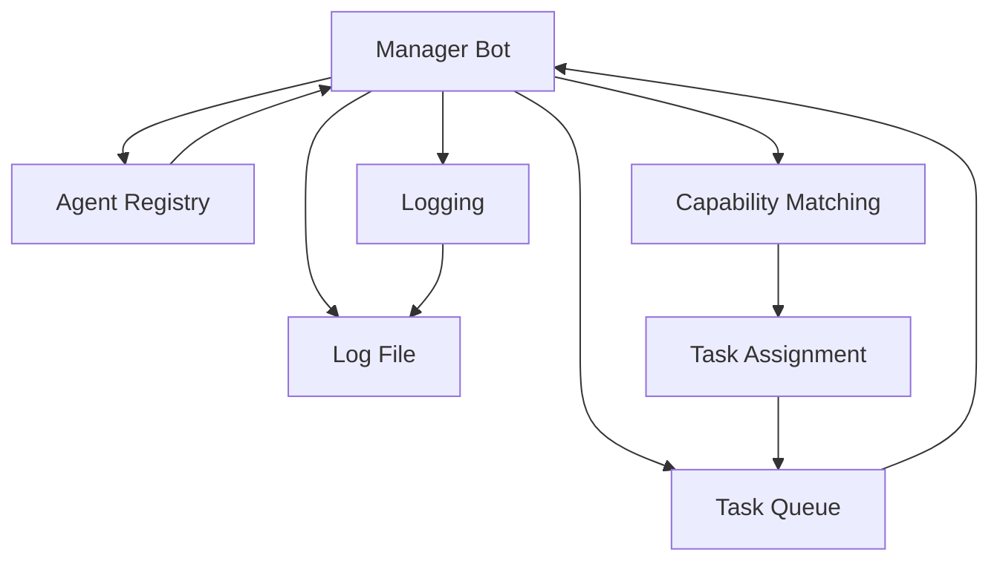

# Manager Bot Module

## Overview

Simple Manager Bot prototype for task coordination. Can read tasks from the queue, assign tasks to agents, track completion, and log all operations. **Now includes agent type recognition and capability-based task assignment.**

## Architecture



## Agent Types

Manager Bot recognizes all agent types:

### Engineering Agents
- **implementation-engineer** - Code implementation, bug fixes, features
- **pedantic-senior-engineer** - Code review, refactoring, architectural analysis
- **performance-engineer** - Performance analysis, optimization

### Testing Agents
- **exploratory-tester-data-scientist** - Data analysis, log analysis, telemetry
- **exploratory-tester-ui-clicker** - UI testing, UX testing, edge cases
- **simple-playtester** - Goal testing, regression testing
- **full-game-playtester** - Simulation testing, balance testing
- **fun-inspector** - Fun analysis, playability assessment
- **economist-tester** - Economic testing, balance testing

### Research Agents
- **credibility-analyst** - Research validation, source evaluation
- **creative-filter** - Creative application, cross-domain analysis
- **emergent-effects-researcher** - Emergent system research
- **literature-survey-agent** - Literature review, research analysis

### Consultation Agents
- **aesthetic-consultant** - Aesthetic analysis, visual feedback
- **gameplay-consultant** - Gameplay analysis, design feedback

### Orchestration Agents
- **manager-bot** - Orchestration, task delegation, sprint planning
- **pr-agent** - PR management, code review
- **conflict-resolution-agent** - Conflict resolution, merge handling

### Retrospective Agent
- **retrospective-agent** - Retrospective, issue analysis, systemic issues

## API

### ManagerBot::new(task_queue_path: &str, log_file: &str) -> ManagerBot
Create a new Manager Bot with the given task queue path and log file.

### ManagerBot::read_pending_tasks() -> Result<Vec<Task>, String>
Read all pending tasks from the queue and log the count.

### ManagerBot::assign_task(task_id: &str, agent: &str) -> Result<(), String>
Assign a specific task to a specific agent and log the assignment.

### ManagerBot::auto_assign_tasks(agents: &[&str]) -> Result<Vec<String>, String>
**NEW: Capability-based assignment instead of round-robin.**

Auto-assign all pending tasks to appropriate agents based on task type inference and agent capabilities. Returns list of assignments with agent types.

**Task Type Inference:**
- "test", "verify" → testing
- "implement", "build", "create" → code-implementation
- "refactor", "clean", "improve" → refactoring
- "research", "analyze", "review" → research-validation
- "design", "architect" → architectural-analysis
- "bug", "fix" → bug-fix
- "feature" → feature-development
- "performance", "optimize" → performance-analysis
- "data", "log", "telemetry" → data-analysis
- "ui", "ux", "interface" → ui-testing
- "play", "simulate", "balance" → simulation-testing
- default → code-implementation

**Example:**
```rust
let manager = ManagerBot::new("tasks/todo.txt", "tasks/manager.log");
let pending = manager.read_pending_tasks().unwrap();
let assignments = manager.auto_assign_tasks(&[]).unwrap();
// Assignments like: "task_1 -> implementation-engineer (code-implementation)"
```

### ManagerBot::mark_task_complete(task_id: &str) -> Result<(), String>
Mark a task as complete and log the completion.

### ManagerBot::get_all_tasks() -> Result<Vec<Task>, String>
Get all tasks regardless of status.

### ManagerBot::print_summary() -> Result<(), String>
Print a summary of task counts by status.

## Capability Matching

Manager Bot matches tasks to agents based on:

### Task Type Inference
Uses keyword matching on task description to infer task type.

### Agent Capabilities
Each agent type has a set of capabilities it can handle:

**Implementation Engineer:**
- code-implementation, bug-fix, feature-development, testing, refactoring

**Pedantic Senior Engineer:**
- code-review, refactoring, architectural-analysis, complexity-analysis

**Performance Engineer:**
- performance-analysis, optimization, profiling, resource-management

**Exploratory Tester (Data Scientist):**
- data-analysis, log-analysis, telemetry-analysis, pattern-detection

**Exploratory Tester (UI Clicker):**
- ui-testing, ux-testing, edge-case-testing, user-flow-testing

**Simple Playtester:**
- goal-testing, regression-testing, functional-testing, feature-testing

**Full Game Playtester:**
- simulation-testing, balance-testing, long-term-testing, end-to-end-testing

**Fun Inspector:**
- fun-analysis, playability-assessment, engagement-analysis, pacing-analysis

**Credibility Analyst:**
- research-validation, source-evaluation, credibility-assessment, academic-analysis

**Creative Filter:**
- creative-application, cross-domain-analysis, mechanic-borrowing, innovation-proposal

**Emergent Effects Researcher:**
- emergent-system-research, complexity-analysis, emergent-mechanic-proposal, system-architecture

**Economist Tester:**
- economic-testing, balance-testing, economic-simulation, resource-analysis

**Aesthetic Consultant:**
- aesthetic-analysis, visual-feedback, design-consultation, art-direction

**Gameplay Consultant:**
- gameplay-analysis, game-design-feedback, player-experience, mechanic-evaluation

**Manager Bot:**
- orchestration, task-delegation, sprint-planning, agent-coordination

**PR Agent:**
- pr-management, code-review, merge-management, workflow-coordination

**Conflict Resolution Agent:**
- conflict-resolution, merge-conflict-handling, integration-management

**Literature Survey Agent:**
- literature-review, research-analysis, academic-sourcing, domain-research

**Retrospective Agent:**
- retrospective, issue-analysis, systemic-issue-detection, improvement-proposal

## Example Usage

```rust
use manager_bot::ManagerBot;

fn main() {
    let manager = ManagerBot::new("tasks/todo.txt", "tasks/manager.log");

    // Read pending tasks
    let pending = manager.read_pending_tasks().unwrap();

    // Auto-assign tasks based on capabilities
    let assignments = manager.auto_assign_tasks(&[]).unwrap();

    for assignment in assignments {
        println!("{}", assignment);
        // Output: "task_1 -> implementation-engineer (code-implementation)"
    }

    // Print summary
    manager.print_summary().unwrap();
}
```

## Workflow

1. Manager Bot reads pending tasks from Task Queue
2. Manager Bot infers task type from description
3. Manager Bot finds agent with matching capability
4. Manager Bot assigns task to appropriate agent
5. Manager Bot logs assignment
6. Agent executes task (not implemented in this prototype)
7. Manager Bot marks task complete when notified

## Log Format

Log file contains timestamped entries:
```
Read 3 pending tasks
Assigned task task_1 to agent implementation-engineer (code-implementation)
Assigned task task_2 to agent exploratory-tester-data-scientist (data-analysis)
Marked task task_1 as complete
```

## Testing

Unit tests are included in the module. Run with:
```bash
cargo test --package game2-core
```

## Future Enhancements

- Integrate with agent knowledge bases for capability assessment
- Implement sprint planning with task dependencies
- Add task prioritization based on dependencies
- Add agent capability assessment based on historical performance
- Add task dependency resolution
- Implement retrospective workflow
- Add worktree management for parallel agent work
