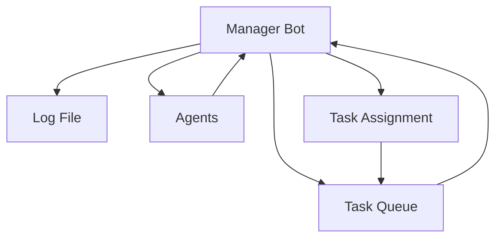

# Manager Bot Module

## Overview

Simple Manager Bot prototype for task coordination. Can read tasks from the queue, assign tasks to agents, track completion, and log all operations.

## Architecture



## API

### ManagerBot::new(task_queue_path: &str, log_file: &str) -> ManagerBot
Create a new Manager Bot with the given task queue path and log file.

### ManagerBot::read_pending_tasks() -> Result<Vec<Task>, String>
Read all pending tasks from the queue and log the count.

### ManagerBot::assign_task(task_id: &str, agent: &str) -> Result<(), String>
Assign a specific task to a specific agent and log the assignment.

### ManagerBot::auto_assign_tasks(agents: &[&str]) -> Result<Vec<String>, String>
Auto-assign all pending tasks to available agents using round-robin. Returns list of assignments.

### ManagerBot::mark_task_complete(task_id: &str) -> Result<(), String>
Mark a task as complete and log the completion.

### ManagerBot::get_all_tasks() -> Result<Vec<Task>, String>
Get all tasks regardless of status.

### ManagerBot::print_summary() -> Result<(), String>
Print a summary of task counts by status.

## Example Usage

```rust
use manager_bot::ManagerBot;

fn main() {
    let manager = ManagerBot::new("tasks/todo.txt", "tasks/manager.log");

    // Read pending tasks
    let pending = manager.read_pending_tasks().unwrap();

    // Auto-assign to agents
    let agents = vec!["Agent A", "Agent B"];
    let assignments = manager.auto_assign_tasks(&agents).unwrap();

    // Print summary
    manager.print_summary().unwrap();
}
```

## Workflow

1. Manager Bot reads pending tasks from Task Queue
2. Manager Bot assigns tasks to agents (manually or auto-assign)
3. Agents execute tasks (not implemented in this prototype)
4. Manager Bot marks tasks complete when notified
5. All operations logged to log file

## Log Format

Log file contains timestamped entries:
```
Read 3 pending tasks
Assigned task task_1 to agent Implementation Engineer
Marked task task_1 as complete
```

## Testing

Unit tests are included in the module. Run with:
```bash
cargo test --package game2-core
```

## Current Limitations

This is a prototype. Future enhancements needed:
- Actual agent execution (currently just logs assignments)
- Task dependencies and ordering
- Agent capability matching
- Sprint planning integration
- Knowledge base updates
- Retrospective functionality

## Future Enhancements

- Integrate with agent knowledge bases
- Implement sprint planning
- Add task prioritization
- Add agent capability assessment
- Add task dependency resolution
- Implement retrospective workflow
